[🇮🇹 Italiano](MANUALE_COSTRUZIONE.md) · **🇬🇧 English**

<div align="center">

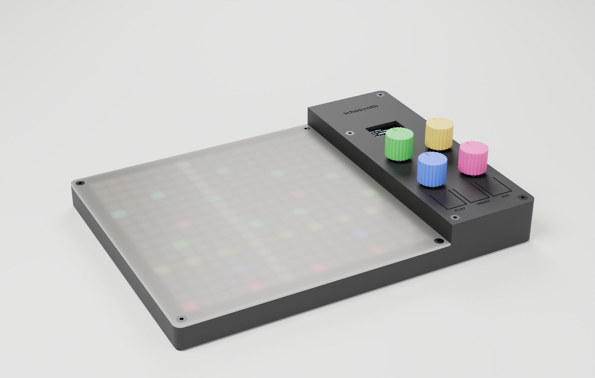

# 🔧 ichosynth — Build Manual

### The real TŒRN firmware on hand-soldered hardware · 4 encoders · 3 buttons · OLED · 16×16 matrix

[-orange.svg)](#2--difficulty-tools-safety)
[](https://toern.live)
[](USAGE_MANUAL.md)

</div>

> 📄 **The graphic guides** (printable, almost no text — in Italian, but the pictures speak):
> **[Wiring](_DOCS/CABLAGGIO.pdf)** — 7 plates, one wire at a time ·
> **[3D case assembly](_CASE/MONTAGGIO.pdf)** — 18 pages ·
> **[Bench quick-start](_WORKSHOP/QUICKSTART_COSTRUZIONE.md)** — the checklist.
> This manual explains the why of each step and keeps the reference tables.

## In short

**ichosynth** is a cheap, hand-soldered build of **TŒRN** (by SP_ / soundpauli,
[toern.live](https://toern.live)): an open-source sampler-sequencer on a **Teensy 4.1**. It runs the
**real TŒRN firmware**; the expensive parts are replaced by cheap ones:

| Original TŒRN | ichosynth |
|---|---|
| 4 I²C RGB encoders (Duppa) | **4 KY-040 encoders** (turn + push) |
| 3 capacitive pads | **3 tact switches** PLAY · MENU · REC |
| encoder ring colours | **0.96" OLED**: channel, mode, transport, BPM, volume, page |
| dedicated PCB | **soldered wires** (no PCB) |

Everything else — DSP, sequencer, sampler — is the unchanged TŒRN firmware. A computer is only
needed to load the firmware the first time; power comes from **USB (5 V)**.

<p align="center">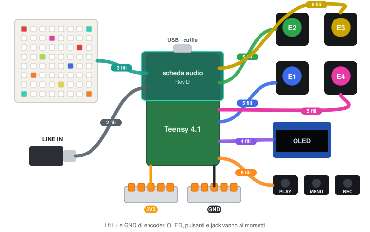</p>

## 📑 Contents

1. [What you need](#1--what-you-need)
2. [Difficulty, tools, safety](#2--difficulty-tools-safety)
3. [Prepare the Teensy and the audio board](#3--prepare-the-teensy-and-the-audio-board)
4. [Wiring](#4--wiring)
5. [3D-printed case (optional)](#5--3d-printed-case-optional)
6. [Load the firmware](#6--load-the-firmware)
7. [Prepare the micro SD](#7--prepare-the-micro-sd)
8. [First power-on](#8--first-power-on)
9. [If something is wrong](#9--if-something-is-wrong)
10. [Pin summary](#10--pin-summary)

---

## 1 · What you need

<table>
<tr>
<td align="center" width="25%">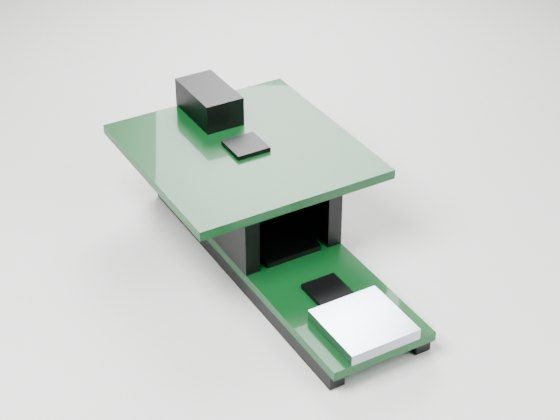<br><b>Teensy 4.1 + Audio Rev D</b> ×1</td>
<td align="center" width="25%">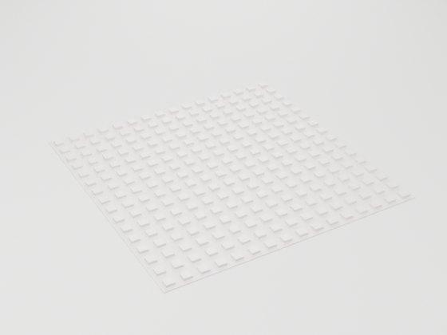<br><b>WS2812B 16×16 matrix</b> ×1</td>
<td align="center" width="25%">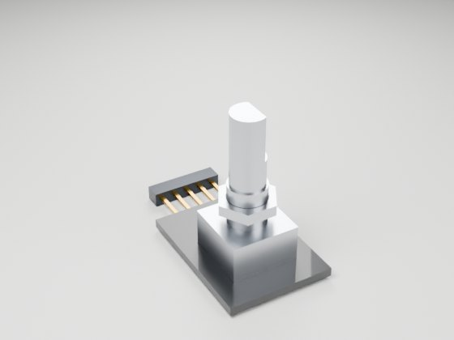<br><b>KY-040 encoder</b> ×4</td>
<td align="center" width="25%">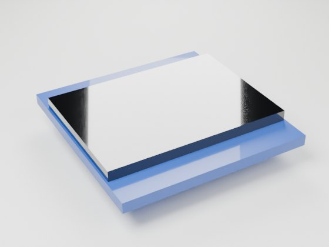<br><b>SSD1306 0.96" OLED</b> ×1</td>
</tr>
<tr>
<td align="center">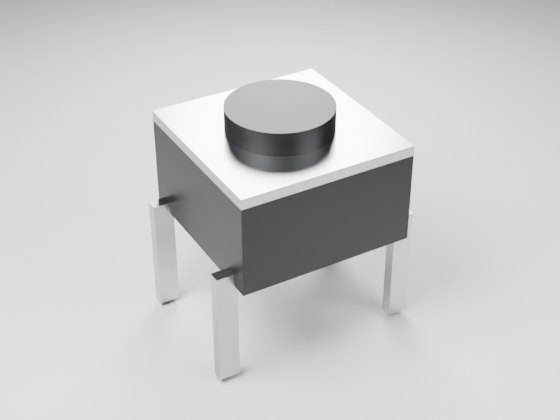<br><b>6×6 tact switch</b> ×3</td>
<td align="center">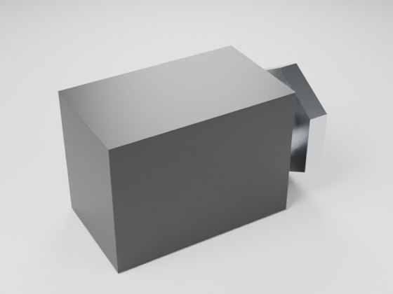<br><b>6.35 mm mono jack</b> ×1</td>
<td align="center">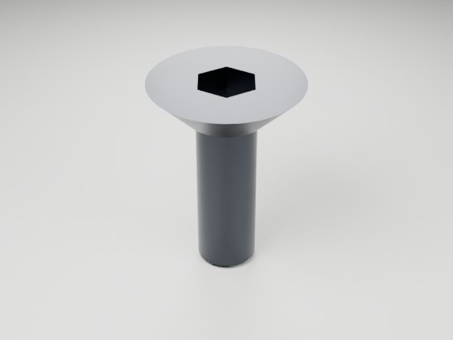<br><b>M3×8 countersunk screws</b> ×8 <sub>(case)</sub></td>
<td align="center">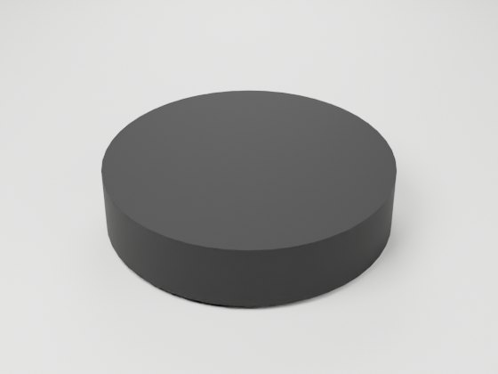<br><b>Adhesive feet</b> ×4 <sub>(case)</sub></td>
</tr>
</table>

| Qty | Part | Notes |
|-----|------|-------|
| 1 | **Teensy 4.1** | the microcontroller |
| 2 | **8 MB PSRAM** chips (APS6404) | **both mandatory** (16 MB): TŒRN uses ~16.5 MB of external memory |
| 1 | **Teensy Audio Adaptor Rev D** (for Teensy 4.x) | SGTL5000 codec + 3.5 mm headphone jack |
| 1 | **WS2812B 16×16** LED matrix (256 LEDs) | rigid or flexible (160 mm) |
| **4** | **KY-040** encoder with push-button | E1 … E4 |
| **3** | **6×6 mm** tact switches | PLAY · MENU · REC — **4.3 mm tall** if you use the case |
| 1 | **SSD1306 0.96" 128×64 I²C** OLED | replaces the encoders' colour rings |
| 1 | Panel-mount **6.35 mm mono TS** jack | LINE IN, for recording (the output is the audio board's headphone jack) |
| 1 | **Class 10** micro SD, ≤ 32 GB, FAT32 | samples and patterns |
| 1 | **Data** micro-USB cable + 5 V ≥ 2 A supply | power and programming |
| 1 | Headphones with a 3.5 mm jack | no speakers on board |
| 2 | **Long male pin header** strips (≥ 15 mm, 14 pins) | to stack the audio board on the Teensy |
| 2 | *(recommended)* 5-pole **lever connectors** (e.g. WAGO 221-415) | 3.3 V and GND bus bars, no soldering |
| as needed | AWG 26 wire in 6+ colours | ~20 wires of 10-15 cm |
| 1 | *(optional)* **3D-printed case** | [`_CASE/`](_CASE/) — 3 parts, 2 plates 250×250 |

> ℹ️ **Samples**: the factory set in `_SDCARD/` is **public domain** (the *drum_sklad* collection),
> freely redistributable. You can add your own (see [ch. 7](#7--prepare-the-micro-sd)).

---

## 2 · Difficulty, tools, safety

| Part | Difficulty | Notes |
|---|---|---|
| Wiring matrix, encoders, buttons, OLED | 🟢 easy | soldering on large pins, one wire at a time |
| **PSRAM** (2 SMD chips under the Teensy) | 🔴 hard | **buy the Teensy with the PSRAM already fitted**, or have it soldered |

**Tools:** fine-tip soldering iron + solder (and flux), wire stripper, side cutters, tweezers,
helping hands, **multimeter** (essential), isopropyl alcohol. An antistatic strap is recommended.

**Four rules that save your parts:**
1. **Never** connect or disconnect wires with USB plugged in.
2. **All grounds (GND) together.** Encoders and OLED at **3.3 V**, never 5 V: only the matrix gets 5 V.
3. After each group of joints, multimeter in continuity mode: **no short** between 5 V and GND or 3.3 V and GND.
4. Take your time: a "cold" joint (dull, ball-shaped) is the #1 cause of faults.

> ⏱️ Time: half a day if you already solder (PSRAM excluded).

---

## 3 · Prepare the Teensy and the audio board

**3.1 · PSRAM** — if your Teensy doesn't have it yet, solder **both** chips on the pads underneath.
Without both, the firmware won't start.

**3.2 · Stack the audio board**

<p align="center">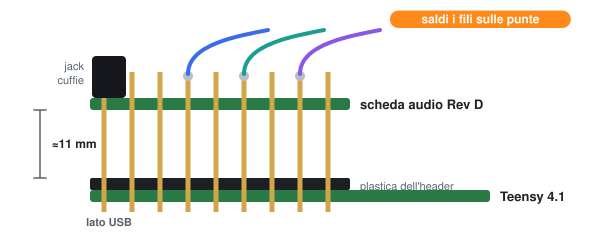</p>

1. Solder **2 strips of 14 long male headers** to the Teensy: the first 14 positions on each side,
   from the USB end down, plastic resting on the Teensy.
2. Slide the audio board on with its **headphone jack on the same side as the USB**, about 11 mm up,
   and solder it.
3. The tips sticking out above the audio board **are the Teensy's pins**: the wires for the pins
   covered by the audio board are soldered there.

The audio signals (I²S + I²C) are then already connected. If you wire the audio board by hand instead:

| Audio signal | Teensy pin | | Audio signal | Teensy pin |
|---|---|---|---|---|
| MCLK | **23** | | SDA (I²C) | **18** |
| BCLK | **21** | | SCL (I²C) | **19** |
| LRCLK | **20** | | 3.3 V | **3.3V** |
| TX (data to codec) | **7** | | GND | **GND** |
| RX (data from codec) | **8** | | | |

> ⚠️ **Don't fit the volume pot** on the audio board: its pad (A1) is pin 15, used by E1.
>
> 💾 The micro SD goes in the **Teensy 4.1's own slot** (at the bottom of the board), not the audio board's.

---

## 4 · Wiring

> 🎨 Fully illustrated version for the bench: **[`_DOCS/CABLAGGIO.pdf`](_DOCS/CABLAGGIO.pdf)**.
> The pin numbers there and here come from the firmware drivers (`ICHOS_ENC_PINS`, `ICHOS_BTN_PINS`
> in `teensy/libraries/`).

<p align="center">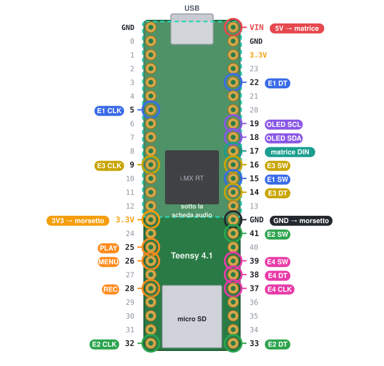</p>

The Teensy is seen **from the top with USB up**; coloured pins are the ones you use. The dashed area
is covered by the audio board: those pins are soldered on the long header tips.

> 🧭 **Don't use pins 2 / 3 / 4** (internal to TŒRN) or **24** (LED strip removed in this build).

### 4.1 · Power: two lever connectors

<p align="center">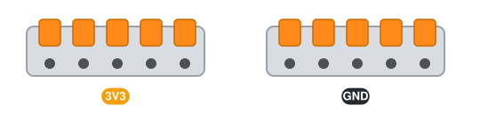</p>

| From the Teensy | To the connector | Where |
|---|---|---|
| **3.3V** | **3V3** connector | left side, 15th pin from the top (outside the audio board) |
| **GND** | **GND** connector | right side, 15th pin from the top |

The **+** and **GND** of the 4 encoders and the OLED, and the GND of the buttons and the jack, go to them.

### 4.2 · KY-040 encoders (×4)

<table><tr>
<td>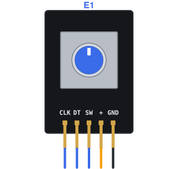</td>
<td>

| Encoder | CLK | DT | SW | + | GND |
|---|---|---|---|---|---|
| **E1** | **5** | **22** | **15** | 3V3 | GND |
| **E2** | **32** | **33** | **41** | 3V3 | GND |
| **E3** | **9** | **14** | **16** | 3V3 | GND |
| **E4** | **37** | **38** | **39** | 3V3 | GND |

The labels **CLK DT SW + GND** are printed on the module: follow yours.
If an encoder turns the wrong way, **swap CLK and DT**.

</td>
<td>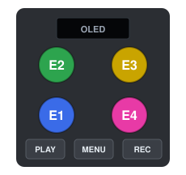</td>
</tr></table>

With the case the encoders sit 2×2: **E2 E3 on top, E1 E4 at the bottom** (E1 and E4 move the
cursor in DRAW: the most used, nearest the hand). Without the case, lay them out as you like.

### 4.3 · PLAY · MENU · REC buttons

<table><tr>
<td>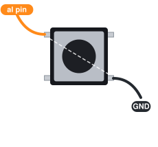</td>
<td>

| Button | Teensy pin | Other leg |
|---|---|---|
| **PLAY** | **25** | GND |
| **MENU** | **26** | GND |
| **REC** | **28** | GND |

Use **two diagonal legs**: it always switches, whichever way you fit it.
No resistors: the firmware uses the internal pull-ups.

</td></tr></table>

### 4.4 · OLED

<table><tr>
<td>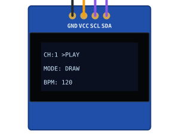</td>
<td>

| OLED pin | Goes to |
|---|---|
| **GND** | GND connector |
| **VCC** | 3V3 connector |
| **SCL** | pin **19** |
| **SDA** | pin **18** |

It shares SDA/SCL with the audio board (different addresses: OLED 0x3C).
⚠️ On some modules **VCC and GND are swapped**: follow your board's labels.

</td></tr></table>

### 4.5 · LED matrix

<table><tr>
<td>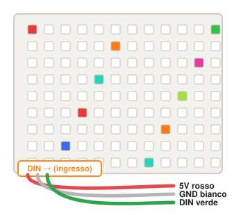</td>
<td>

| Matrix wire | Goes to |
|---|---|
| **5V** (red) | pin **VIN** (right side, 1st from the top) |
| **GND** (white) | GND connector |
| **DIN** (green) | pin **17** |

Use the connector where the arrow goes **in** (DIN), not DOUT. Wire colours vary between makers:
the PCB label is what counts. The firmware keeps the brightness low, USB is enough.

</td></tr></table>

### 4.6 · Audio: LINE IN and headphones

<table><tr>
<td>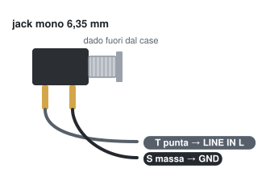</td>
<td>

| Jack | Connection |
|---|---|
| **LINE IN** 6.35 mm mono | tip → audio board **LINE IN L** pad, sleeve → GND |
| **Headphones** 3.5 mm | the audio board's own jack: no wires |

LINE IN is mono (TŒRN samples the left channel) and is this build's default recording input.
If the source hums, a 10 µF capacitor in series with the signal.

</td></tr></table>

> 🎹 **MIDI (optional)**: TŒRN speaks DIN MIDI on Serial8 — **pin 34 = IN, 35 = OUT** — through a
> small optocoupler circuit (not included). The firmware does not handle MIDI over USB.

### 4.7 · Check before powering on

- [ ] every wire on the right number (compare with the map above);
- [ ] **only** the matrix's red wire goes to 5 V (VIN);
- [ ] multimeter: **no short** 5 V–GND and 3.3 V–GND;
- [ ] no solder bridges between neighbouring pins.

---

## 5 · 3D-printed case (optional)

<p align="center">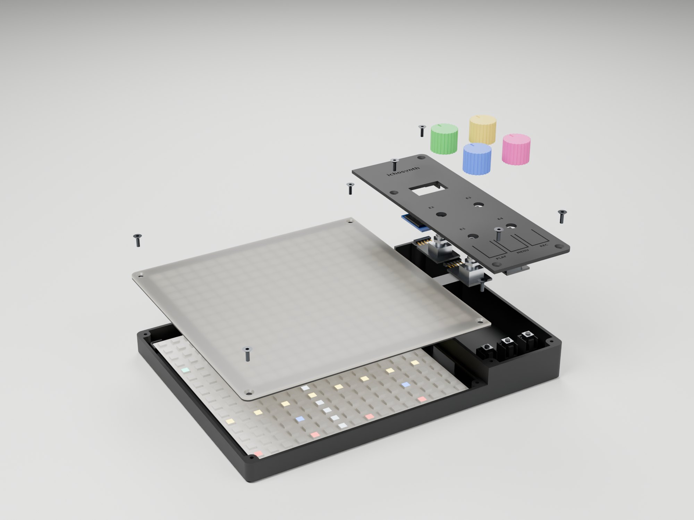</p>

A stepped case, **3 parts on 2 plates** of the Anycubic Kobra S1, **no supports**: opaque tray and
panel, translucent diffuser with the light-baffle grid built in (colour change at 1.4 mm).
Headphones and USB exit at the back, LINE IN on the side; the buttons are flexible tabs cut into
the panel.

<table><tr>
<td align="center">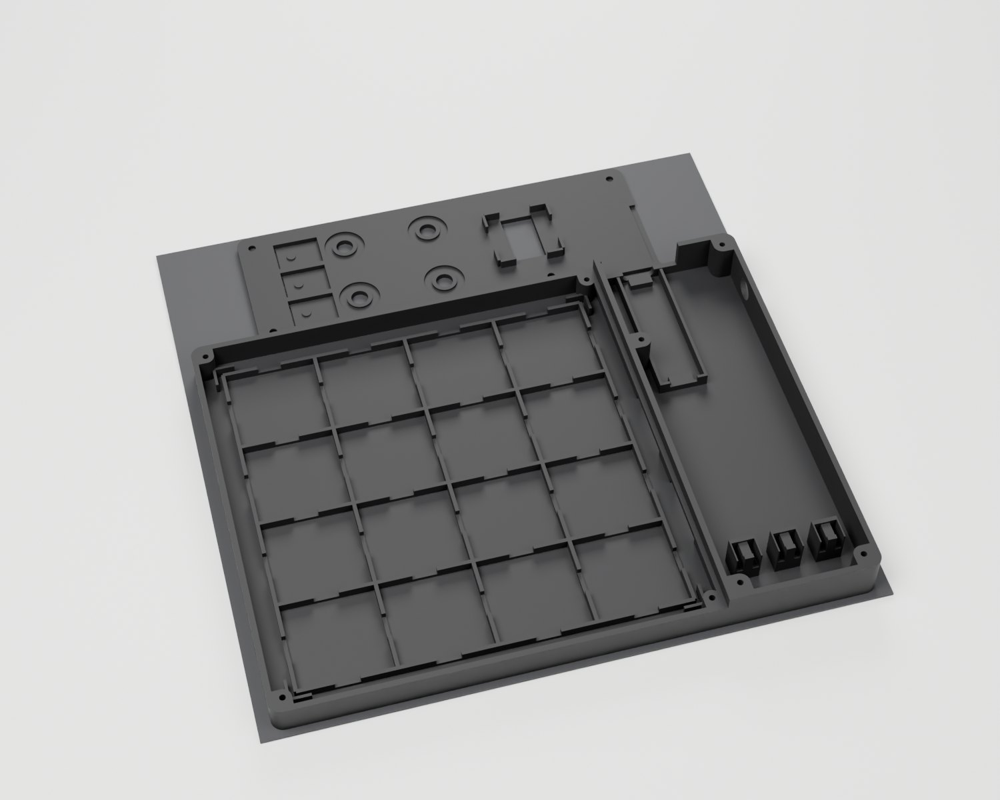<br>plate 1 · black</td>
<td align="center">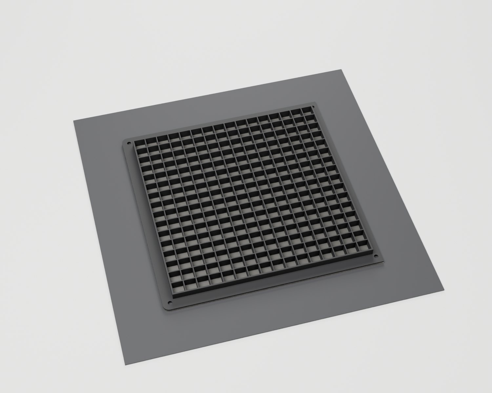<br>plate 2 · translucent</td>
</tr></table>

👉 Step-by-step guide: **[`_CASE/MONTAGGIO.pdf`](_CASE/MONTAGGIO.pdf)** · printing and parameters:
[`_CASE/README.md`](_CASE/README.md). With the case: encoders 2×2, **4.3 mm** switches, soldered
wires (no Dupont), LINE IN jack ≤ 22 × 16 mm behind the wall.

---

## 6 · Load the firmware

**The easy way — one-click flasher (Windows):**
1. connect the Teensy over USB;
2. open **`_FLASHER/flasher.exe`** (first run, SmartScreen: *More info → Run anyway*);
3. press **⚡ Flash ichosynth** and, when asked, the small **PROGRAM** button on the Teensy;
4. wait for *"Firmware written and Teensy rebooted"*.

The flasher already contains the compiled firmware (`_FLASHER/ichosynth.hex`) and checks the file
is intact before writing it.

**Building from source:**
```sh
python teensy/build_toern.py            # -> teensy/firmware/toern.hex
python teensy/build_toern.py --flash    # build and flash (teensy_loader_cli)
```
Needs `arduino-cli` with the `teensy:avr` core (≥ 1.61.0). The script takes the TŒRN sources at the
verified version, adapts the pins to our parts, uses the Teensy core's FastLED and compiles at
`-O1` (at `-O2` the compiler crashes on TŒRN's ~23,000-line file). Details and patches:
[`teensy/README.md`](teensy/README.md).

---

## 7 · Prepare the micro SD

<p align="center">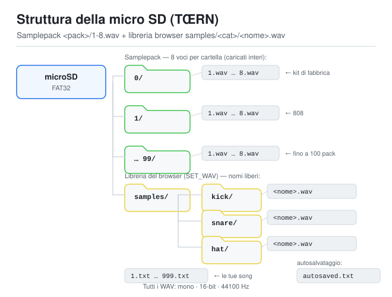/1-8.wav and browser library samples/<category>/<name>.wav" width="620"></p>

- **Samplepacks** — folders `0` … `99` at the root, each with **8 voices** `1.wav` … `8.wav`
  (one per channel). Pack 0 is the factory kit.
- **Browser library** — `samples/<category>/<name>.wav`, browsed voice by voice in **SET_WAV**
  (up to 256 files per folder, names up to 60 characters).
- **Format: mono WAV, 16-bit, 44100 Hz.**

The quickest way: **copy the contents of [`_SDCARD/`](_SDCARD/) to the root** of a FAT32 SD card
(6 packs + library ready to go).

**Adding your own samples** — `_SDCARD/wavmaker.exe` (or `python _SDCARD/wavmaker_gui.py`):
1. pick the **mode**: *Samplepack* (8 voices → `<pack>/1-8.wav`, order with ↑ ↓) or *Library*;
2. **Add files/folder**: green rows are already in the right format;
3. **Scan** the SD (finds the next free pack) or write to a local folder;
4. **Convert**. The originals stay unless you choose to delete them.

wavmaker only formats **removable SD cards** and asks for confirmation showing disk and partitions.
To regenerate the factory set: `python _SDCARD/build_samples.py`.

---

## 8 · First power-on

1. SD in the Teensy slot, headphones in, USB.
2. The matrix shows the **logo**; the OLED shows **CH / MODE / BPM / VOL / PAGE**.
3. Red **noSD** icon? Power off, check the SD (FAT32, Teensy slot), power on again.
4. Turn the encoders: cursor and values respond. Press **PLAY**: the sequence starts.
5. Plug a source into LINE IN and use **REC** to record it into a channel (see the Usage Manual).

> 🎮 To play it: **[Usage Manual](USAGE_MANUAL.md)** and the control map
> [`_DOCS/MAPPA_CONTROLLI.md`](_DOCS/MAPPA_CONTROLLI.md).

---

## 9 · If something is wrong

| Symptom | Fix |
|--------|-----|
| 🔌 The PC doesn't see it | **data** USB cable (not charge-only); 5 V–GND short; header joints |
| 🔁 It reboots by itself | PSRAM missing or badly soldered (2 chips needed); ≥ 2 A supply |
| 💡 LEDs off or wrong colours | DIN not on pin 17; output connector instead of input; no common GND |
| ↩️ An encoder turns the wrong way | swap that encoder's **CLK and DT** |
| ⏩ One click moves two steps | set `ICHOS_ENC_COUNTS_PER_DETENT` to 2 in the driver and rebuild |
| 🔇 Encoder or button does nothing | wrong pin: check the [map](#4--wiring); a button goes pin → GND |
| 💾 noSD icon | SD in the **Teensy's** slot, FAT32, ≤ 32 GB |
| 🎧 No sound | audio board badly stacked; volume at 0; use the audio board's headphone jack |
| 🚫 A channel is silent | WAV not mono/16-bit/44.1 kHz or wrong path: use wavmaker |
| 📟 OLED stays black | VCC/GND swapped; SDA/SCL swapped; address 0x3D |
| ❌ The build fails | `arduino-cli` + `teensy:avr` core installed? run `python teensy/build_toern.py` |

---

## 10 · Pin summary

```
LED matrix    DIN 17 · 5V from VIN · GND
Encoder E1    CLK 5   DT 22  SW 15        Audio (stacked)   MCLK 23 · BCLK 21 · LRCLK 20
Encoder E2    CLK 32  DT 33  SW 41                          TX 7 · RX 8 · SDA 18 · SCL 19
Encoder E3    CLK 9   DT 14  SW 16        OLED              SDA 18 · SCL 19 · 3V3 · GND (0x3C)
Encoder E4    CLK 37  DT 38  SW 39        LINE IN           tip → LINE IN L · sleeve → GND
Buttons       PLAY 25 · MENU 26 · REC 28  (pin → GND)        DIN MIDI (opt.)   IN 34 · OUT 35
Avoid         2 / 3 / 4 (TŒRN internal) · 24 · don't fit the volume pot (A1 = pin 15)
Power         matrix 5 V (VIN) · encoders, OLED, audio 3.3 V · all GNDs together
```

---

<div align="center">

Happy building! 🛠️ When it plays, move on to the **[Usage Manual](USAGE_MANUAL.md)**.

*ichosynth is a cheap, hand-soldered build of **TŒRN** by SP_ (soundpauli, https://toern.live) · open-source firmware on a Teensy 4.1.*

</div>
