**🇮🇹 Italiano** · [🇬🇧 English](BUILD_MANUAL.md)

<div align="center">

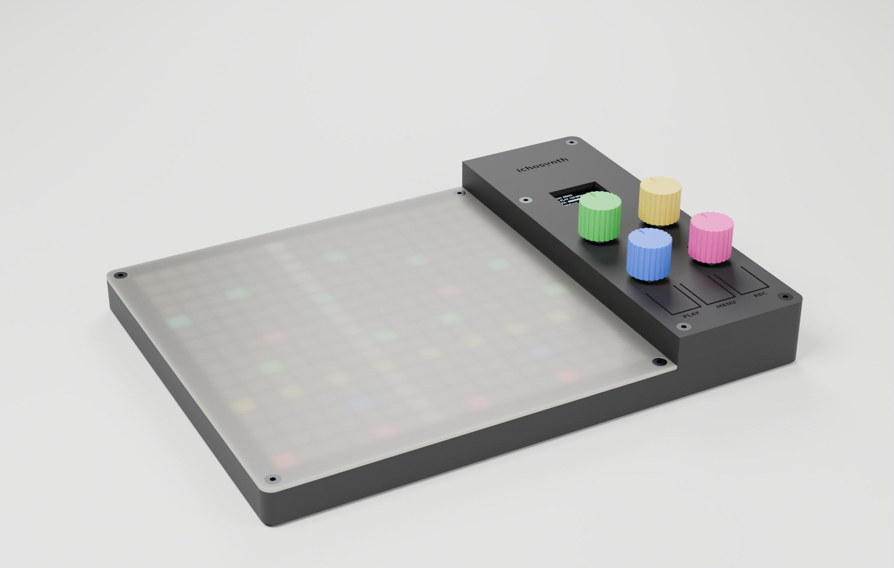

# 🔧 ichosynth — Manuale di costruzione

### Il vero firmware TŒRN su hardware saldato a mano · 4 encoder · 3 tasti · OLED · matrice 16×16

[-orange.svg)](#2--difficoltà-strumenti-sicurezza)
[](https://toern.live)
[](MANUALE_USO.md)

</div>

> 📄 **Le guide grafiche** (stampabili, quasi senza testo):
> **[Cablaggio](_DOCS/CABLAGGIO.pdf)** — 7 tavole, un filo alla volta ·
> **[Montaggio del case 3D](_CASE/MONTAGGIO.pdf)** — 18 pagine ·
> **[Quick-start da banco](_WORKSHOP/QUICKSTART_COSTRUZIONE.md)** — la checklist.
> Questo manuale spiega il perché di ogni passo e tiene le tabelle di riferimento.

## In breve

**ichosynth** è una build economica, saldata a mano, di **TŒRN** (di SP_ / soundpauli,
[toern.live](https://toern.live)): un campionatore-sequencer open-source su **Teensy 4.1**. Gira il
**vero firmware TŒRN**; le parti costose sono sostituite da parti economiche:

| TŒRN originale | ichosynth |
|---|---|
| 4 encoder RGB I²C (Duppa) | **4 encoder KY-040** (ruota + premi) |
| 3 pad capacitivi | **3 tact switch** PLAY · MENU · REC |
| colore degli anelli degli encoder | **OLED 0,96"**: canale, modo, trasporto, BPM, volume, pagina |
| PCB dedicato | **fili saldati** (nessun PCB) |

Tutto il resto — DSP, sequencer, campionatore — è il firmware TŒRN invariato. Il computer serve
solo per caricare il firmware la prima volta; alimentazione dalla **USB (5 V)**.

<p align="center">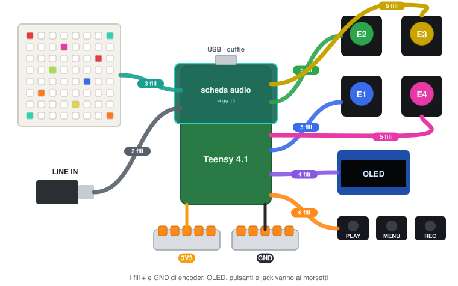</p>

## 📑 Indice

1. [Cosa ti serve](#1--cosa-ti-serve)
2. [Difficoltà, strumenti, sicurezza](#2--difficoltà-strumenti-sicurezza)
3. [Prepara il Teensy e la scheda audio](#3--prepara-il-teensy-e-la-scheda-audio)
4. [Cablaggio](#4--cablaggio)
5. [Case stampato 3D (opzionale)](#5--case-stampato-3d-opzionale)
6. [Carica il firmware](#6--carica-il-firmware)
7. [Prepara la micro SD](#7--prepara-la-micro-sd)
8. [Primo avvio](#8--primo-avvio)
9. [Se qualcosa non va](#9--se-qualcosa-non-va)
10. [Schema riassuntivo dei pin](#10--schema-riassuntivo-dei-pin)

---

## 1 · Cosa ti serve

<table>
<tr>
<td align="center" width="25%">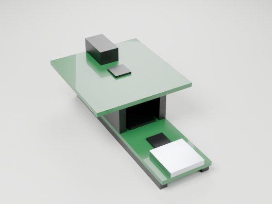<br><b>Teensy 4.1 + Audio Rev D</b> ×1</td>
<td align="center" width="25%">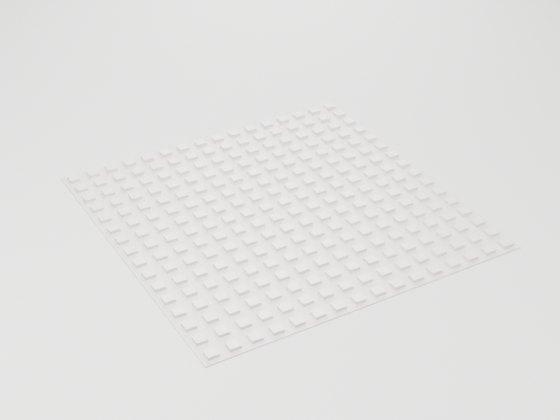<br><b>Matrice WS2812B 16×16</b> ×1</td>
<td align="center" width="25%">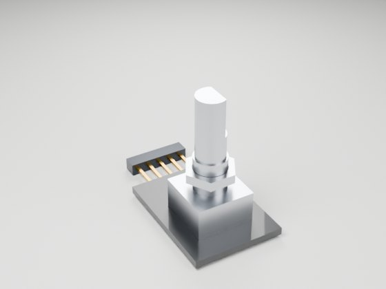<br><b>Encoder KY-040</b> ×4</td>
<td align="center" width="25%">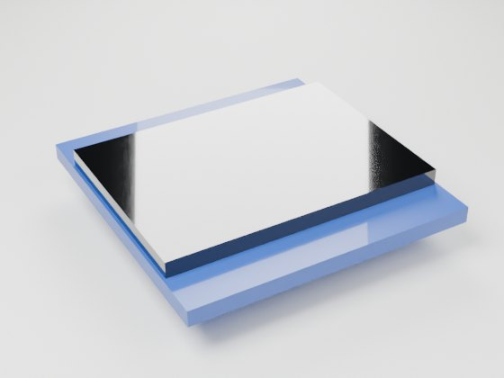<br><b>OLED SSD1306 0,96"</b> ×1</td>
</tr>
<tr>
<td align="center">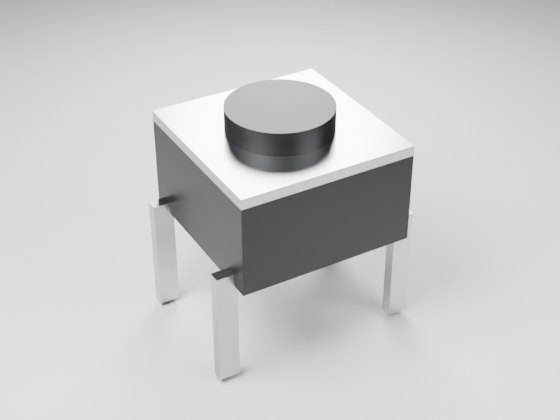<br><b>Tact switch 6×6</b> ×3</td>
<td align="center">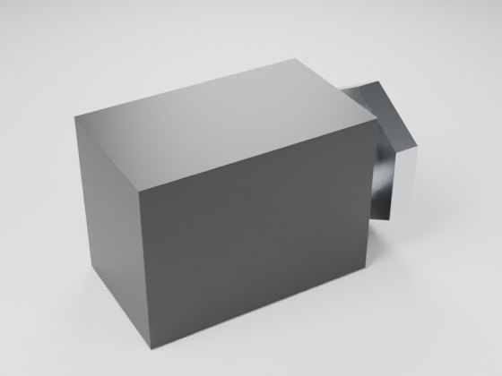<br><b>Jack mono 6,35 mm</b> ×1</td>
<td align="center">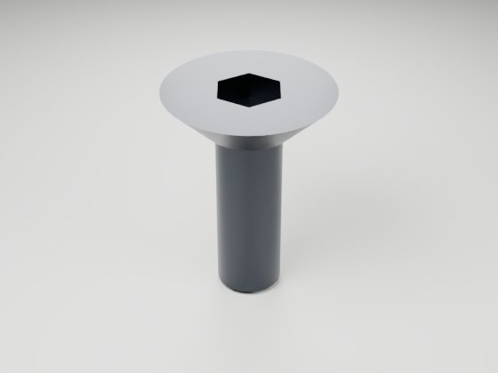<br><b>Viti M3×8 svasate</b> ×8 <sub>(case)</sub></td>
<td align="center">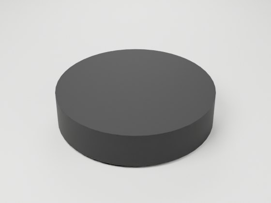<br><b>Piedini adesivi</b> ×4 <sub>(case)</sub></td>
</tr>
</table>

| Q.tà | Componente | Note |
|------|------------|------|
| 1 | **Teensy 4.1** | il microcontrollore |
| 2 | Chip **PSRAM 8 MB** (APS6404) | **entrambi obbligatori** (16 MB): TŒRN usa ~16,5 MB di memoria esterna |
| 1 | **Teensy Audio Adaptor Rev D** (per Teensy 4.x) | codec SGTL5000 + jack cuffie 3,5 mm |
| 1 | Matrice LED **WS2812B 16×16** (256 LED) | rigida o flessibile (160 mm) |
| **4** | Encoder **KY-040** con pulsante | E1 … E4 |
| **3** | Tact switch **6×6 mm** | PLAY · MENU · REC — **alti 4,3 mm** se usi il case |
| 1 | OLED **SSD1306 0,96" 128×64 I²C** | sostituisce gli anelli colorati degli encoder |
| 1 | Jack **mono TS 6,35 mm** da pannello | LINE IN, per registrare (l'uscita è il jack cuffie della scheda audio) |
| 1 | Micro SD **Class 10**, ≤ 32 GB, FAT32 | campioni e pattern |
| 1 | Cavo micro-USB **dati** + alimentatore 5 V ≥ 2 A | alimentazione e programmazione |
| 1 | Cuffie con jack 3,5 mm | niente altoparlanti a bordo |
| 2 | Strisce di **header maschi lunghi** (≥ 15 mm, 14 pin) | per impilare la scheda audio sul Teensy |
| 2 | *(consigliati)* **Morsetti a leva** 5 poli (es. WAGO 221-415) | barre 3,3 V e GND senza saldare |
| q.b. | Filo AWG 26 in 6+ colori | ~20 fili da 10-15 cm |
| 1 | *(facoltativo)* **Case stampato 3D** | [`_CASE/`](_CASE/) — 3 pezzi, 2 piatti 250×250 |

> ℹ️ **Campioni**: il set di fabbrica in `_SDCARD/` è **public domain** (raccolta *drum_sklad*),
> ridistribuibile liberamente. Puoi aggiungere i tuoi (vedi [cap. 7](#7--prepara-la-micro-sd)).

---

## 2 · Difficoltà, strumenti, sicurezza

| Parte | Difficoltà | Note |
|---|---|---|
| Cablaggio di matrice, encoder, tasti, OLED | 🟢 facile | saldature su pin grandi, un filo alla volta |
| **PSRAM** (2 chip SMD sul retro del Teensy) | 🔴 difficile | **compra il Teensy con la PSRAM già saldata**, o fattela saldare |

**Strumenti:** saldatore a punta fine + stagno (e flussante), spelafili, tronchesino, pinzette,
terza mano, **multimetro** (fondamentale), alcol isopropilico. Bracciale antistatico consigliato.

**Quattro regole che salvano i componenti:**
1. **Mai** collegare o scollegare fili con la USB inserita.
2. **Tutte le masse (GND) insieme.** Encoder e OLED a **3,3 V**, mai a 5 V: solo la matrice va a 5 V.
3. Dopo ogni gruppo di saldature, multimetro in continuità: **nessun corto** fra 5 V e GND e fra 3,3 V e GND.
4. Calma: una saldatura "fredda" (opaca, a pallina) è la causa n°1 di guasti.

> ⏱️ Tempo: mezza giornata per chi sa già saldare (PSRAM esclusa).

---

## 3 · Prepara il Teensy e la scheda audio

**3.1 · PSRAM** — se il tuo Teensy non l'ha già, salda i **due** chip nelle piazzole sul retro. Senza
entrambi il firmware non parte.

**3.2 · Impila la scheda audio**

<p align="center">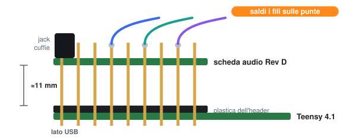</p>

1. Salda **2 strisce da 14 header maschi lunghi** sul Teensy: le prime 14 posizioni di ogni lato,
   dalla USB in giù, con la plastica appoggiata sul Teensy.
2. Infila la scheda audio con il **jack cuffie dallo stesso lato della USB**, a circa 11 mm, e saldala.
3. Le punte che sporgono sopra la scheda audio **sono i pin del Teensy**: i fili per i pin coperti dalla
   scheda audio si saldano lì.

Così i segnali audio (I²S + I²C) sono già collegati. Se invece cabli la scheda audio a mano:

| Segnale audio | Pin Teensy | | Segnale audio | Pin Teensy |
|---|---|---|---|---|
| MCLK | **23** | | SDA (I²C) | **18** |
| BCLK | **21** | | SCL (I²C) | **19** |
| LRCLK | **20** | | 3,3 V | **3.3V** |
| TX (dati al codec) | **7** | | GND | **GND** |
| RX (dati dal codec) | **8** | | | |

> ⚠️ **Non montare il potenziometro del volume** sulla scheda audio: il suo pad (A1) è il pin 15, usato da E1.
>
> 💾 La micro SD va nello **slot del Teensy 4.1** (in basso sulla scheda), non in quello della scheda audio.

---

## 4 · Cablaggio

> 🎨 Versione tutta illustrata, da tenere sul banco: **[`_DOCS/CABLAGGIO.pdf`](_DOCS/CABLAGGIO.pdf)**.
> I numeri dei pin lì e qui sono quelli dei driver del firmware (`ICHOS_ENC_PINS`, `ICHOS_BTN_PINS`
> in `teensy/libraries/`).

<p align="center">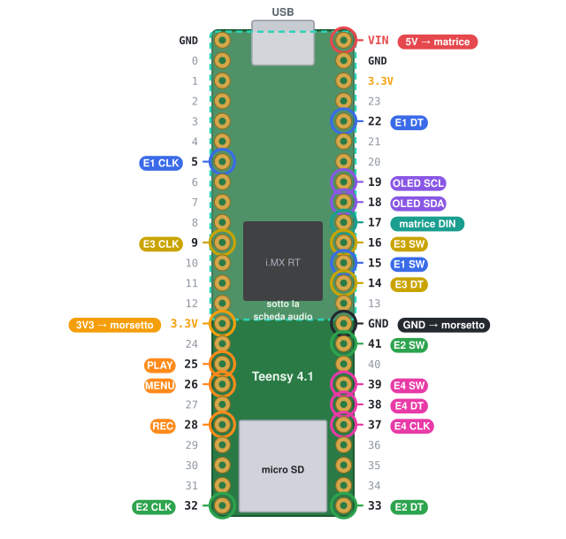</p>

Il Teensy è visto **da sopra con la USB in alto**; i pin colorati sono quelli che usi. La zona
tratteggiata è coperta dalla scheda audio: quei pin si saldano sulle punte degli header lunghi.

> 🧭 **Non usare i pin 2 / 3 / 4** (interni a TŒRN) né il **24** (striscia LED rimossa in questa build).

### 4.1 · Alimentazione: due morsetti

<p align="center">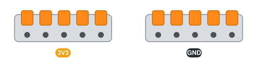</p>

| Dal Teensy | Al morsetto | Dove |
|---|---|---|
| **3.3V** | morsetto **3V3** | lato sinistro, 15° pin dall'alto (fuori dalla scheda audio) |
| **GND** | morsetto **GND** | lato destro, 15° pin dall'alto |

Ai morsetti vanno poi il **+** e il **GND** dei 4 encoder e dell'OLED, e il GND dei tasti e del jack.

### 4.2 · Encoder KY-040 (×4)

<table><tr>
<td>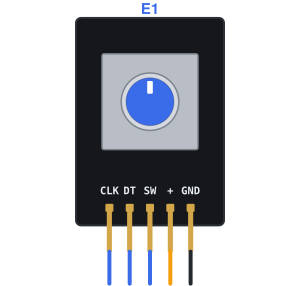</td>
<td>

| Encoder | CLK | DT | SW | + | GND |
|---|---|---|---|---|---|
| **E1** | **5** | **22** | **15** | 3V3 | GND |
| **E2** | **32** | **33** | **41** | 3V3 | GND |
| **E3** | **9** | **14** | **16** | 3V3 | GND |
| **E4** | **37** | **38** | **39** | 3V3 | GND |

Le scritte **CLK DT SW + GND** sono stampate sul modulo: segui le tue.
Se un encoder gira al contrario, **scambia CLK e DT**.

</td>
<td>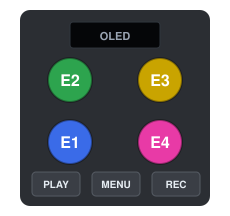</td>
</tr></table>

Con il case gli encoder stanno in 2×2: **E2 E3 in alto, E1 E4 in basso** (E1 ed E4 muovono il cursore
in DRAW: sono i più usati, vicino alla mano). Senza case disponili come preferisci.

### 4.3 · Tasti PLAY · MENU · REC

<table><tr>
<td>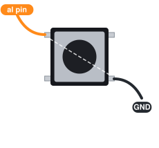</td>
<td>

| Tasto | Pin Teensy | Altra gamba |
|---|---|---|
| **PLAY** | **25** | GND |
| **MENU** | **26** | GND |
| **REC** | **28** | GND |

Usa **due gambe in diagonale**: il contatto c'è sempre, in qualunque verso lo monti.
Nessuna resistenza: il firmware usa i pull-up interni.

</td></tr></table>

### 4.4 · OLED

<table><tr>
<td>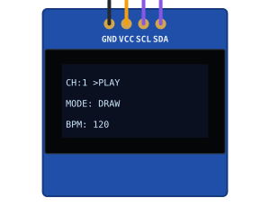</td>
<td>

| Pin OLED | Va a |
|---|---|
| **GND** | morsetto GND |
| **VCC** | morsetto 3V3 |
| **SCL** | pin **19** |
| **SDA** | pin **18** |

Condivide SDA/SCL con la scheda audio (indirizzi diversi: OLED 0x3C).
⚠️ Su alcuni moduli **VCC e GND sono invertiti**: segui le scritte del tuo.

</td></tr></table>

### 4.5 · Matrice LED

<table><tr>
<td>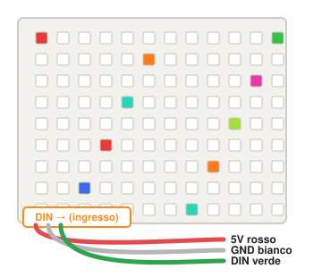</td>
<td>

| Filo della matrice | Va a |
|---|---|
| **5V** (rosso) | pin **VIN** (lato destro, 1° in alto) |
| **GND** (bianco) | morsetto GND |
| **DIN** (verde) | pin **17** |

Usa il connettore dove la freccia **entra** (DIN), non DOUT. I colori dei fili cambiano fra
produttori: conta la scritta sul PCB. Il firmware tiene bassa la luminosità, la USB basta.

</td></tr></table>

### 4.6 · Audio: LINE IN e cuffie

<table><tr>
<td>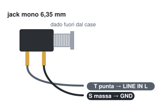</td>
<td>

| Jack | Collegamento |
|---|---|
| **LINE IN** 6,35 mm mono | punta → pad **LINE IN L** della scheda audio, massa → GND |
| **Cuffie** 3,5 mm | il jack della scheda audio: nessun filo |

Il LINE IN è mono (TŒRN campiona il canale sinistro) ed è l'ingresso di registrazione
predefinito di questa build. Se la sorgente ronza, un condensatore da 10 µF in serie sul segnale.

</td></tr></table>

> 🎹 **MIDI (facoltativo)**: TŒRN parla MIDI DIN sulla seriale Serial8 — **pin 34 = IN, 35 = OUT** —
> con un piccolo circuito con optoisolatore (non incluso). Il MIDI via USB non è gestito dal firmware.

### 4.7 · Controllo prima di accendere

- [ ] ogni filo al numero giusto (confronta con la mappa sopra);
- [ ] a 5 V va **solo** il rosso della matrice (VIN);
- [ ] multimetro: **nessun corto** 5 V–GND e 3,3 V–GND;
- [ ] nessuna goccia di stagno fra pin vicini.

---

## 5 · Case stampato 3D (opzionale)

<p align="center">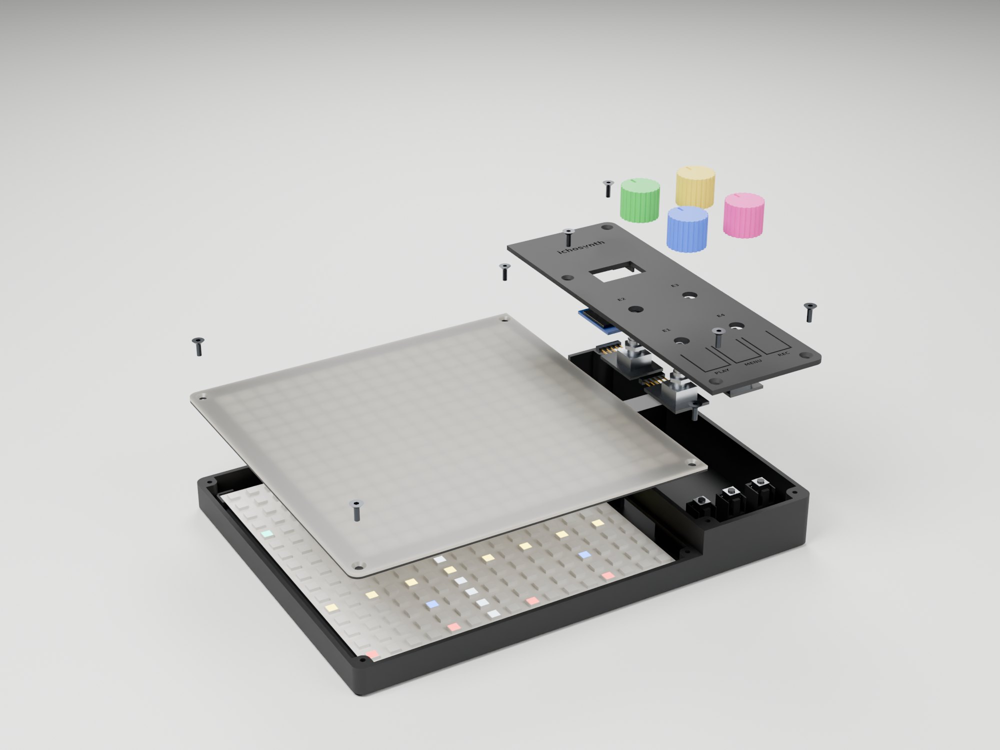</p>

Case a gradino, **3 pezzi su 2 piatti** della Anycubic Kobra S1, **nessun supporto**: vasca e pannello
opachi, diffusore traslucido con la griglia anti-alone incorporata (cambio colore a 1,4 mm). Cuffie e
USB escono dal retro, LINE IN dal fianco; i tasti sono linguette flessibili ricavate nel pannello.

<table><tr>
<td align="center">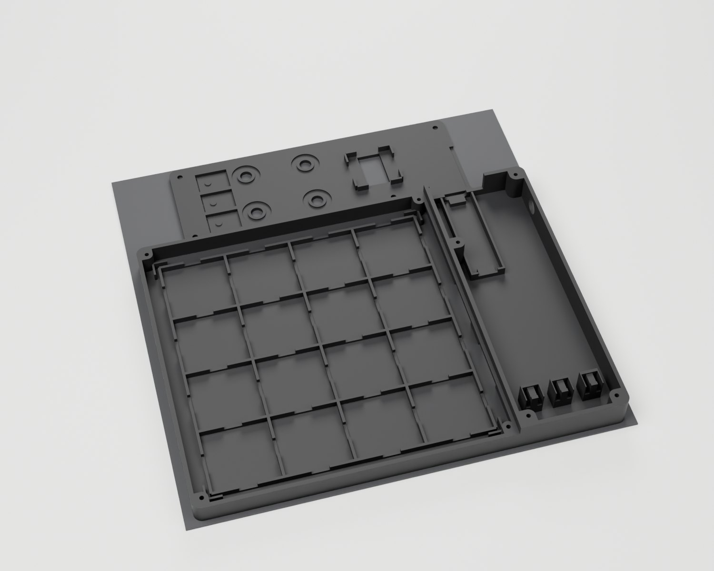<br>piatto 1 · nero</td>
<td align="center">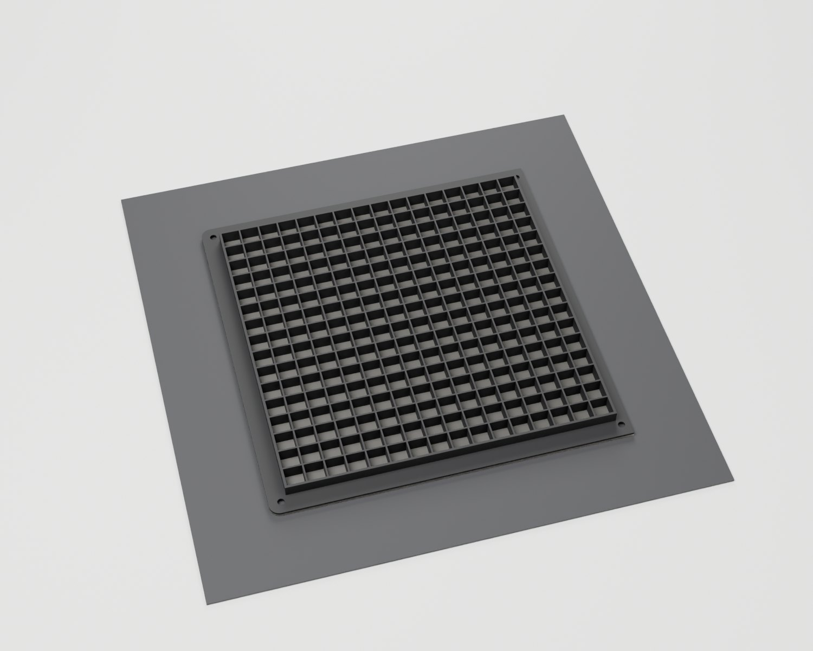<br>piatto 2 · traslucido</td>
</tr></table>

👉 Guida passo-passo: **[`_CASE/MONTAGGIO.pdf`](_CASE/MONTAGGIO.pdf)** · stampa e parametri:
[`_CASE/README.md`](_CASE/README.md). Con il case: encoder in 2×2, switch **alti 4,3 mm**, fili
saldati (niente Dupont), jack LINE IN con ingombro ≤ 22 × 16 mm dietro la parete.

---

## 6 · Carica il firmware

**Il modo più semplice — flasher a un clic (Windows):**
1. collega il Teensy via USB;
2. apri **`_FLASHER/flasher.exe`** (al primo avvio SmartScreen: *Ulteriori informazioni → Esegui comunque*);
3. premi **⚡ Flash ichosynth** e, quando te lo chiede, il pulsantino **PROGRAM** sul Teensy;
4. attendi *"Firmware scritto e Teensy riavviato"*.

Il flasher contiene già il firmware compilato (`_FLASHER/ichosynth.hex`) e controlla che il file
sia integro prima di scriverlo.

**Compilare dai sorgenti:**
```sh
python teensy/build_toern.py            # -> teensy/firmware/toern.hex
python teensy/build_toern.py --flash    # compila e flasha (teensy_loader_cli)
```
Serve `arduino-cli` con il core `teensy:avr` (≥ 1.61.0). Lo script prende i sorgenti TŒRN alla
versione verificata, adatta i pin ai nostri componenti, usa la FastLED del core Teensy e compila
a `-O1` (a `-O2` il compilatore va in crash sul file da ~23 000 righe di TŒRN). Dettagli e patch:
[`teensy/README.md`](teensy/README.md).

---

## 7 · Prepara la micro SD

<p align="center">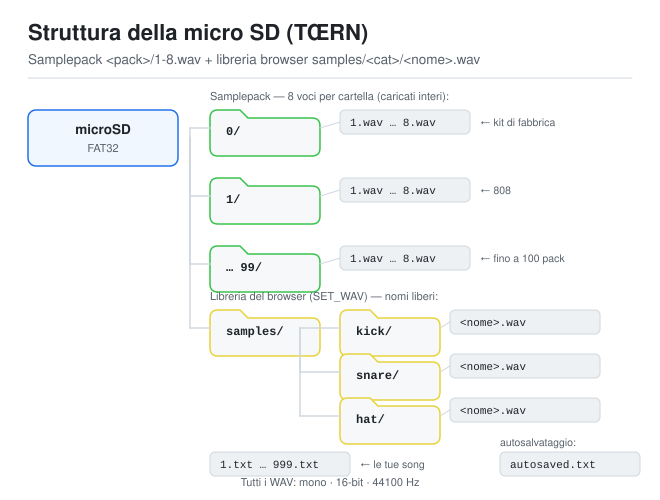/1-8.wav e libreria browser samples/<categoria>/<nome>.wav" width="620"></p>

- **Samplepack** — cartelle `0` … `99` sulla radice, ognuna con **8 voci** `1.wav` … `8.wav`
  (una per canale). Il pack 0 è il kit di fabbrica.
- **Libreria browser** — `samples/<categoria>/<nome>.wav`, da sfogliare voce per voce in **SET_WAV**
  (fino a 256 file per cartella, nomi fino a 60 caratteri).
- **Formato: WAV mono, 16 bit, 44100 Hz.**

Il modo più rapido: **copia il contenuto di [`_SDCARD/`](_SDCARD/) sulla radice** di una SD FAT32
(6 pack + libreria pronti).

**Aggiungere i tuoi campioni** — `_SDCARD/wavmaker.exe` (o `python _SDCARD/wavmaker_gui.py`):
1. scegli la **modalità**: *Samplepack* (8 voci → `<pack>/1-8.wav`, ordine con ↑ ↓) o *Libreria*;
2. **Aggiungi file/cartella**: le righe verdi sono già nel formato giusto;
3. **Scansiona** la SD (trova il prossimo pack libero) o scrivi in una cartella locale;
4. **Converti**. Gli originali restano, a meno che tu non scelga di eliminarli.

wavmaker formatta solo **schede SD removibili** e chiede conferma mostrando disco e partizioni.
Per rigenerare il set di fabbrica: `python _SDCARD/build_samples.py`.

---

## 8 · Primo avvio

1. SD nello slot del Teensy, cuffie collegate, USB.
2. Sulla matrice compare il **logo**; l'OLED mostra **CH / MODE / BPM / VOL / PAGE**.
3. Icona **noSD** rossa? Spegni, controlla la SD (FAT32, slot del Teensy), riaccendi.
4. Gira gli encoder: cursore e valori rispondono. Premi **PLAY**: parte la sequenza.
5. Collega una sorgente al LINE IN e usa **REC** per registrarla in un canale (vedi il Manuale d'Uso).

> 🎮 Per suonarlo: **[Manuale d'Uso](MANUALE_USO.md)** e la mappa comandi
> [`_DOCS/MAPPA_CONTROLLI.md`](_DOCS/MAPPA_CONTROLLI.md).

---

## 9 · Se qualcosa non va

| Sintomo | Rimedio |
|--------|---------|
| 🔌 Il PC non lo riconosce | cavo USB **dati** (non solo-carica); corto 5 V–GND; saldature degli header |
| 🔁 Si riavvia da solo | PSRAM mancante o mal saldata (servono 2 chip); alimentatore ≥ 2 A |
| 💡 LED spenti o colori sbagliati | DIN non sul pin 17; connettore d'uscita invece che d'ingresso; GND non comune |
| ↩️ Un encoder gira al contrario | scambia **CLK e DT** di quell'encoder |
| ⏩ Un click fa due passi | imposta `ICHOS_ENC_COUNTS_PER_DETENT` a 2 nel driver e ricompila |
| 🔇 Encoder o tasto non risponde | pin sbagliato: confronta con la [mappa](#4--cablaggio); il tasto va pin → GND |
| 💾 Icona noSD | SD nello slot del **Teensy**, FAT32, ≤ 32 GB |
| 🎧 Nessun suono | scheda audio impilata male; volume a 0; jack cuffie della scheda audio |
| 🚫 Un canale è muto | WAV non mono/16 bit/44,1 kHz o percorso sbagliato: usa wavmaker |
| 📟 OLED nero | VCC/GND invertiti; SDA/SCL scambiati; indirizzo 0x3D |
| ❌ La build fallisce | `arduino-cli` + core `teensy:avr` installati? lancia `python teensy/build_toern.py` |

---

## 10 · Schema riassuntivo dei pin

```
Matrice LED   DIN 17 · 5V da VIN · GND
Encoder E1    CLK 5   DT 22  SW 15        Audio (impilata)  MCLK 23 · BCLK 21 · LRCLK 20
Encoder E2    CLK 32  DT 33  SW 41                          TX 7 · RX 8 · SDA 18 · SCL 19
Encoder E3    CLK 9   DT 14  SW 16        OLED              SDA 18 · SCL 19 · 3V3 · GND (0x3C)
Encoder E4    CLK 37  DT 38  SW 39        LINE IN           punta → LINE IN L · massa → GND
Tasti         PLAY 25 · MENU 26 · REC 28  (pin → GND)        MIDI DIN (opz.)   IN 34 · OUT 35
Da evitare    2 / 3 / 4 (interni TŒRN) · 24 · non montare il pot del volume (A1 = pin 15)
Alimentazione matrice 5 V (VIN) · encoder, OLED, audio 3,3 V · GND tutti insieme
```

---

<div align="center">

Buona costruzione! 🛠️ Quando suona, passa al **[Manuale d'Uso](MANUALE_USO.md)**.

*ichosynth è una build economica, saldata a mano, di **TŒRN** di SP_ (soundpauli, https://toern.live) · firmware open-source su Teensy 4.1.*

</div>
