<div align="right">

[🇬🇧 English](README.md) · **🇮🇹 Italiano**

</div>

<p align="center">
  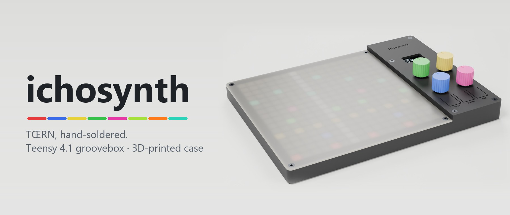
</p>

<p align="center">
  <b>La groovebox <a href="https://toern.live">TŒRN</a> completa, ricostruita con componenti economici da saldare sul tavolo di cucina.</b><br>
  Teensy 4.1 · griglia RGB 16×16 · 4 manopole · 3 tasti · OLED · case stampato in 3D · nessun PCB su misura
</p>

<p align="center">
  <a href="LICENSE"></a>
  <a href="https://www.pjrc.com/store/teensy41.html"></a>
  <a href="https://toern.live"></a>
  <a href="case"></a>
  <a href="docs"></a>
  <a href="https://github.com/luigismith/ichosynth/actions/workflows/build.yml"></a>
</p>

<p align="center">
  <a href="docs/manuals/MANUALE_COSTRUZIONE.md"><b>🔧 Costruiscilo</b></a> &nbsp;·&nbsp;
  <a href="docs/manuals/MANUALE_USO.md"><b>🎛️ Suonalo</b></a> &nbsp;·&nbsp;
  <a href="case"><b>🖨️ Stampa il case</b></a> &nbsp;·&nbsp;
  <a href="https://github.com/luigismith/ichosynth/releases/latest"><b>⬇️ Download</b></a> &nbsp;·&nbsp;
  <a href="emulator/MANUALE.md"><b>🖥️ Emulatore</b></a>
</p>

---

## Cos'è

**ichosynth** esegue il firmware reale e non modificato di **[TŒRN](https://toern.live)**, di
**SP_ (soundpauli)**: campionatore, synth e step sequencer su un Teensy 4.1. Cambiano solo i
componenti di input costosi, sostituiti da parti economiche, e lo strumento è cablato a mano:

| Originale TŒRN | ichosynth | Driver |
|---|---|---|
| 4× encoder RGB I²C Duppa | **4× encoder KY-040** (gira + premi) | [`i2cEncoderLibV2`](firmware/libraries/i2cEncoderLibV2): l'API Duppa sopra `Encoder` |
| 3× pad capacitivi | **3× tact switch**: PLAY · MENU · REC | [`FastTouch`](firmware/libraries/FastTouch) |
| Anelli RGB sugli encoder | **1× OLED SSD1306**: canale · modalità · trasporto · BPM · volume · pagina | [`IchosOled`](firmware/libraries/IchosOled) |

TŒRN è già uno strumento per Teensy 4.1, quindi **arrivano tutte le sue funzioni**. Manca solo la
seconda striscia LED opzionale.

<table>
<tr>
<td width="33%">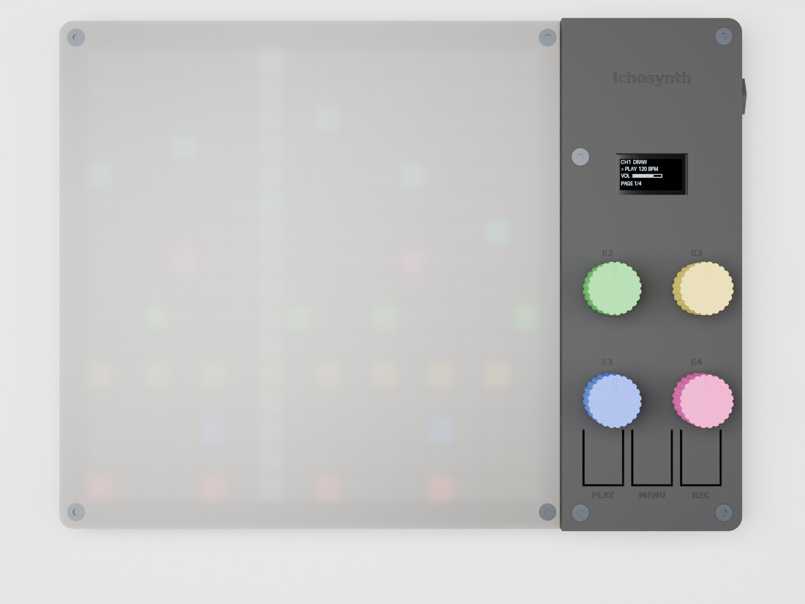</td>
<td width="33%">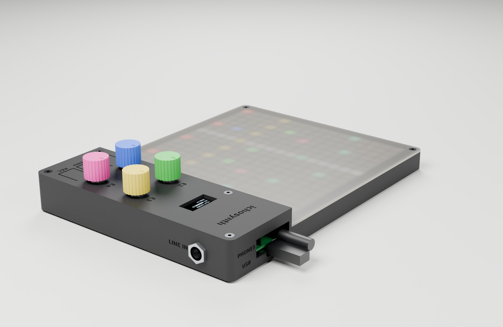</td>
<td width="33%">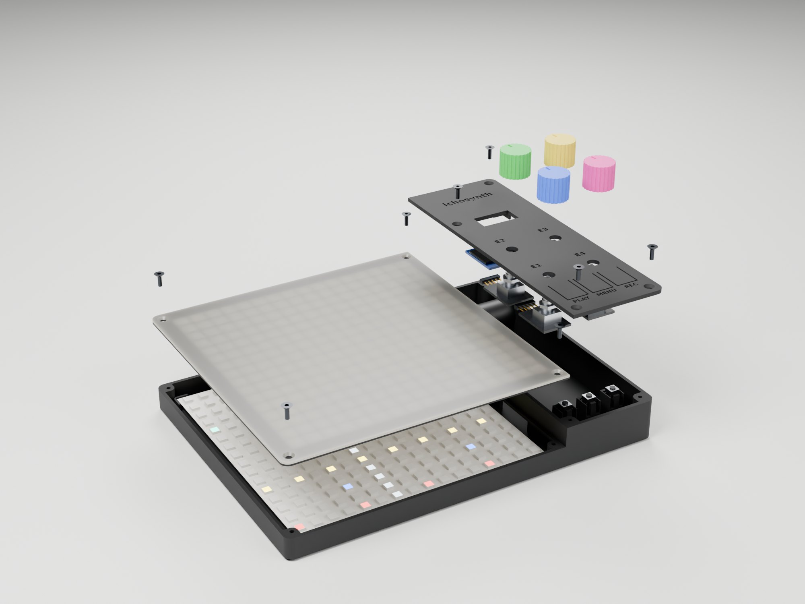</td>
</tr>
<tr>
<td align="center"><sub>griglia 16×16 · OLED · 4 manopole · 3 tasti</sub></td>
<td align="center"><sub>cuffie + USB dietro, LINE IN sul fianco</sub></td>
<td align="center"><sub>3 pezzi stampati, 8 viti</sub></td>
</tr>
</table>

<sub>Render del case generati dallo stesso modello parametrico che produce gli STL.</sub>

## Cosa fa

- 🥁 **8 voci campione + 3 voci synth**, polifoniche, con filtro, **riverbero**, bitcrusher, detune e
  ottava per voce e un **Moog ladder** sui synth
- 🟥 **Griglia RGB 16×16**: ogni riga una voce, ogni colonna un passo; pagine, sotto-pattern e **song mode**
- 🎚️ Per ogni passo **velocity, probabilità e condizioni**, mute, spostamento note, copia e incolla
- 💾 **Sample pack e browser della SD**, con seek, lunghezza e reverse; i brani si salvano sulla SD
- 🎙️ **Registrazione dal vivo** nel campionatore dal **LINE IN da 6,35 mm** (registratore da campo,
  strumenti, altre macchine), con count-in facoltativo
- 🎧 **Uscita cuffie** (3,5 mm stereo) · 🎹 **MIDI DIN** clock e note sui pin 34/35 (circuito opzionale)

La SD contiene già una raccolta di campioni di pubblico dominio ([`sdcard/`](sdcard)). Per
aggiungere i tuoi suoni, [`wavmaker`](tools/wavmaker) converte qualsiasi WAV e prepara la scheda.

<p align="center">
  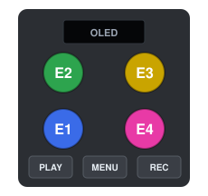
</p>

## Costruiscine uno

<table>
<tr>
<td width="33%" valign="top">
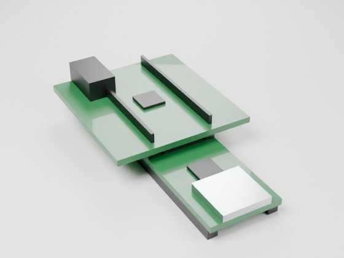<br>
<b>1 · Componenti</b><br>
Teensy 4.1 con 16 MB di PSRAM, scheda audio, matrice LED, 4 KY-040, 3 switch, OLED, un jack.
<a href="docs/manuals/MANUALE_COSTRUZIONE.md#1--cosa-ti-serve">Elenco</a>
</td>
<td width="33%" valign="top">
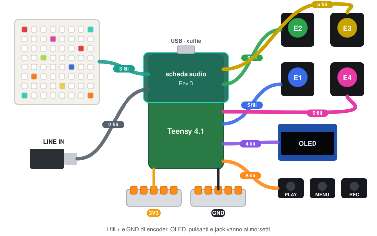<br>
<b>2 · Cablaggio</b><br>
Punto a punto, niente PCB. Ogni filo è disegnato sui componenti veri.
<a href="docs/wiring/CABLAGGIO.pdf">Guida al cablaggio (PDF)</a>
</td>
<td width="33%" valign="top">
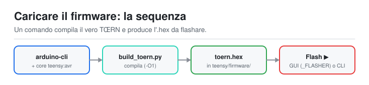<br>
<b>3 · Firmware</b><br>
Un clic con il flasher incluso, senza installare nulla.
<a href="tools/flasher">Flasher</a>
</td>
</tr>
<tr>
<td valign="top">
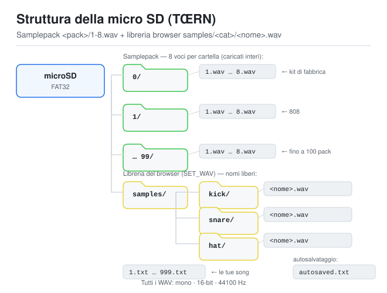<br>
<b>4 · Scheda SD</b><br>
Copia <code>sdcard/</code> su una micro-SD FAT32, oppure lascia fare a <code>wavmaker</code>.
<a href="sdcard/README.md">Struttura della SD</a>
</td>
<td valign="top">
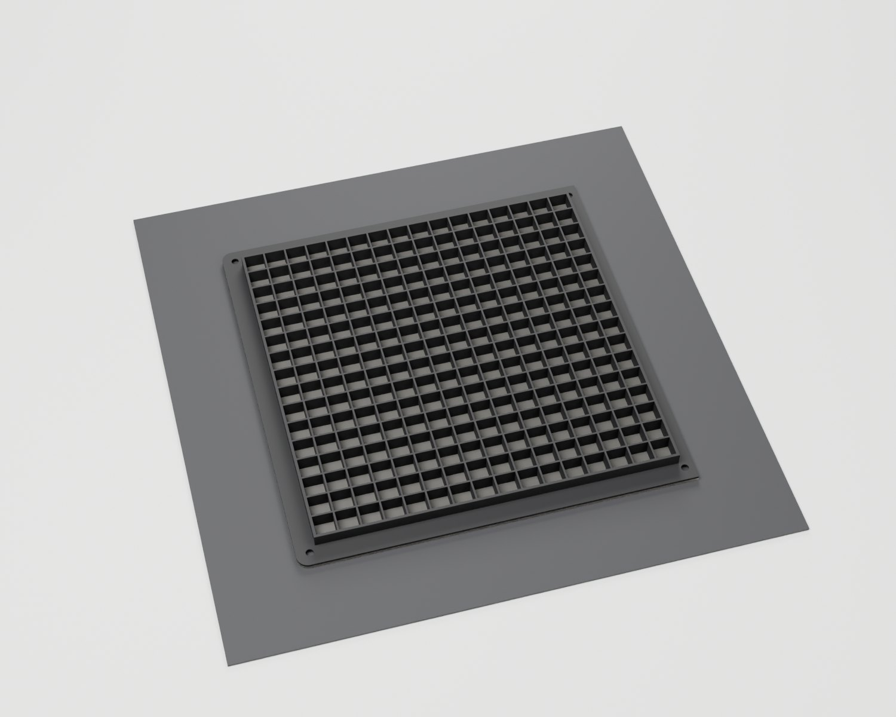<br>
<b>5 · Stampa</b><br>
3 pezzi su 2 piatti, senza supporti. Progetti pronti per Anycubic Slicer Next (PLA o PETG).
<a href="case">Case</a>
</td>
<td valign="top">
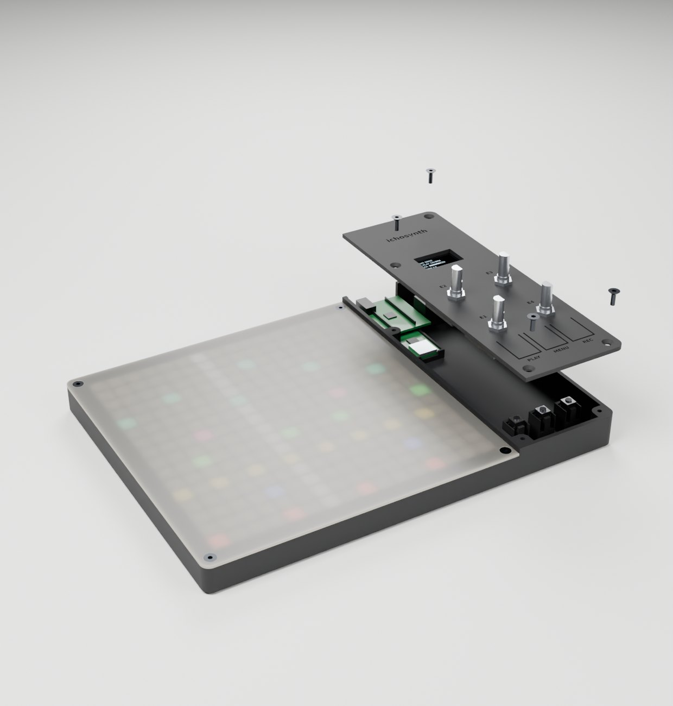<br>
<b>6 · Montaggio</b><br>
Una guida per immagini, stile IKEA, passo per passo.
<a href="case/MONTAGGIO.pdf">Guida al montaggio (PDF)</a>
</td>
</tr>
</table>

> 💾 Sul Teensy servono **entrambi i chip PSRAM (16 MB)**: TŒRN usa circa 16,5 MB e senza non parte.

## Documentazione

| | 🇮🇹 Italiano | 🇬🇧 English |
|---|---|---|
| 🔧 **Manuale di costruzione**: componenti, saldature, cablaggio, case, firmware | [leggi](docs/manuals/MANUALE_COSTRUZIONE.md) · [PDF](docs/manuals/MANUALE_COSTRUZIONE.pdf) | [read](docs/manuals/BUILD_MANUAL.md) · [PDF](docs/manuals/BUILD_MANUAL.pdf) |
| 🎛️ **Manuale d'uso**: come si suona | [leggi](docs/manuals/MANUALE_USO.md) · [PDF](docs/manuals/MANUALE_USO.pdf) | [read](docs/manuals/USAGE_MANUAL.md) · [PDF](docs/manuals/USAGE_MANUAL.pdf) |
| 💻 **Ambiente di sviluppo**: compilare il firmware da sé | [leggi](docs/manuals/MANUALE_AMBIENTE.md) · [PDF](docs/manuals/MANUALE_AMBIENTE.pdf) | [read](docs/manuals/DEV_ENVIRONMENT.md) · [PDF](docs/manuals/DEV_ENVIRONMENT.pdf) |
| 🔌 **Guida al cablaggio** illustrata | [CABLAGGIO.pdf](docs/wiring/CABLAGGIO.pdf) | |
| 🧩 **Montaggio del case**, solo immagini | [MONTAGGIO.pdf](case/MONTAGGIO.pdf) | |
| 🎛️ **Mappa dei controlli** e catalogo funzioni | [MAPPA_CONTROLLI](docs/reference/MAPPA_CONTROLLI.md) · [FEATURE_INVENTORY](docs/reference/FEATURE_INVENTORY.md) | |
| 🎓 **Materiali del workshop**: slide, fascicolo, appunti del docente | [`docs/workshop/`](docs/workshop) | |

## Firmware

Il firmware si costruisce con un solo script: scarica TŒRN a un commit fissato, applica la
rimappatura dei pin e le piccole modifiche per questo hardware, aggiunge l'OLED e compila:

```sh
python firmware/build_toern.py            # -> firmware/build/toern.hex
python firmware/build_toern.py --flash    # compila e carica
```

Serve [`arduino-cli`](https://arduino.github.io/arduino-cli/) con il core `teensy:avr`. La build
usa `-O1`, perché con `-O2` il compilatore del Teensy va in crash sull'unica translation unit da
23.000 righe di TŒRN. Tutte le modifiche sono elencate in [`firmware/README.md`](firmware/README.md).
Il `.hex` già pronto è nel flasher, in [`tools/flasher/`](tools/flasher).

<details>
<summary><b>📌 Mappa dei pin</b></summary>

| Funzione | Pin del Teensy |
|---|---|
| Encoder E1 · E2 · E3 · E4 (CLK / DT / SW) | `5 / 22 / 15` · `32 / 33 / 41` · `9 / 14 / 16` · `37 / 38 / 39` |
| Tasti PLAY · MENU · REC (verso GND) | `25` · `26` · `28` |
| DIN della matrice LED | `17` |
| OLED + codec audio, I²C condiviso | `SDA 18` / `SCL 19` |
| MIDI DIN (opzionale) | `34 RX` / `35 TX` |

La fonte autorevole sono i driver: `ICHOS_ENC_PINS` in
[`i2cEncoderLibV2.h`](firmware/libraries/i2cEncoderLibV2/i2cEncoderLibV2.h) e `ICHOS_BTN_PINS` in
[`FastTouch.h`](firmware/libraries/FastTouch/FastTouch.h). Anche la guida al cablaggio legge i pin da lì.
</details>

<details>
<summary><b>📂 Cosa c'è nel repo</b></summary>

```
ichosynth/
├── docs/
│   ├── manuals/     📖 manuali di costruzione, uso e ambiente di sviluppo (IT + EN, .md + .pdf)
│   ├── wiring/      🔌 guida illustrata al cablaggio (CABLAGGIO.pdf) e il suo generatore
│   ├── reference/   🎛️ mappa dei controlli, catalogo funzioni
│   └── workshop/    🎓 materiali del workshop ICHOS 2026
├── firmware/        🧠 build_toern.py + i tre driver di input (KY-040, switch, OLED)
├── case/            🖨️ case stampato 3D: STL, progetti slicer, verifiche, render, guida al montaggio
├── sdcard/          💾 cosa va sulla micro-SD: sample pack e libreria di campioni
├── tools/
│   ├── flasher/     ⚡ flasher a un clic + il firmware già pronto
│   ├── wavmaker/    🎚️ convertitore WAV e preparazione della SD
│   └── pdf/         📄 generazione dei PDF dei manuali (+ script di setup dell'ambiente)
├── emulator/        🖥️ emulatore desktop (Windows / macOS, SDL2)
├── assets/          🎨 diagrammi, illustrazioni, banner
├── design/          🎨 design system dei diagrammi
└── legacy/          📜 l'NI404 originale di SP_: firmware-banco, PCB, case
```
</details>

## Parte di ICHOS 2026

<p align="center">
  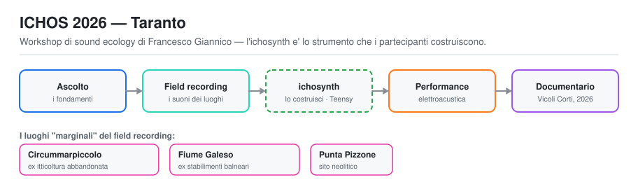
</p>

ichosynth è lo strumento che i partecipanti hanno **costruito con le proprie mani** a
**[ICHOS 2026](https://www.francescogiannico.com/ichos-2026/)**, workshop residenziale di
*ecologia del suono* a **Taranto** (12–14 giugno 2026), ideato e condotto dall'artista sonoro
**Francesco Giannico**. *Ichos*, dal greco antico **ἦχος**, significa "suono".

Tre giorni di **ascolto**, **field recording** nei luoghi marginali di Taranto (l'allevamento
ittico abbandonato di Circummarpiccolo, il fiume Galeso, il sito neolitico di Punta Pizzone),
**costruzione dello strumento** e una **performance elettroacustica** collettiva. I suoni registrati
sul posto diventano ciò che la groovebox suona: **registri un luogo, poi lo esegui su uno strumento
che hai saldato tu.** Al workshop segue un documentario sonoro di **Roberta Trani**.

## Crediti

- **SP_ (soundpauli)** ha scritto **[TŒRN](https://toern.live)**, il firmware che questo strumento
  esegue, e l'**NI404** originale da cui è partito questo repository. Il merito di entrambi resta a SP_.
- **Paul Stoffregen / PJRC** per la piattaforma Teensy e la sua libreria Audio; **Nic Newdigate** per
  `teensy-polyphony` e `teensy-variable-playback`.
- **ICHOS 2026** è ideato e condotto da **Francesco Giannico**. Build, case e documentazione di
  ichosynth sono di **Luigi Massari**, il documentario di **Roberta Trani**.

**Librerie**: TŒRN (SP_, MIT) · Teensy Audio · `teensy-polyphony` / `teensy-variable-playback` ·
`WS2812Serial` · FastLED · Mapf (GPL-3.0) · i driver inclusi `i2cEncoderLibV2`, `FastTouch` e
`IchosOled`.

## Licenza

**MIT**, vedi [LICENSE](LICENSE). TŒRN e ogni libreria mantengono la propria licenza (Mapf è
GPL-3.0): se distribuisci una build, verifica di rispettarle tutte.

<p align="center"><sub>Fatto a Taranto per ICHOS 2026 · ascolta un luogo, poi suonalo.</sub></p>
