<div align="right">

**🇬🇧 English** · [🇮🇹 Italiano](README.it.md)

</div>

<p align="center">
  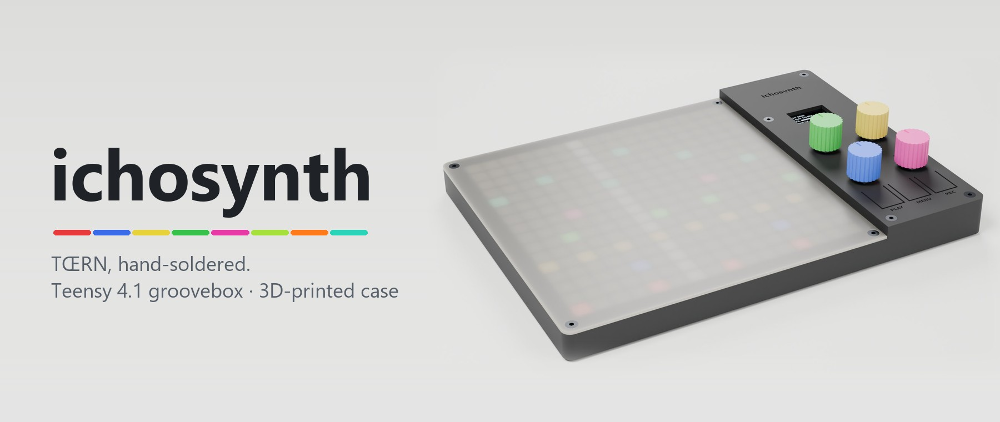
</p>

<p align="center">
  <b>The full <a href="https://toern.live">TŒRN</a> groovebox, rebuilt with cheap parts you can solder on a kitchen table.</b><br>
  Teensy 4.1 · 16×16 RGB grid · 4 knobs · 3 buttons · OLED · 3D-printed case · no custom PCB
</p>

<p align="center">
  <a href="LICENSE"></a>
  <a href="https://www.pjrc.com/store/teensy41.html"></a>
  <a href="https://toern.live"></a>
  <a href="case"></a>
  <a href="docs"></a>
  <a href="https://github.com/luigismith/ichosynth/actions/workflows/build.yml"></a>
</p>

<p align="center">
  <a href="docs/manuals/BUILD_MANUAL.md"><b>🔧 Build it</b></a> &nbsp;·&nbsp;
  <a href="docs/manuals/USAGE_MANUAL.md"><b>🎛️ Play it</b></a> &nbsp;·&nbsp;
  <a href="case"><b>🖨️ Print the case</b></a> &nbsp;·&nbsp;
  <a href="https://github.com/luigismith/ichosynth/releases/latest"><b>⬇️ Downloads</b></a> &nbsp;·&nbsp;
  <a href="emulator/MANUALE.md"><b>🖥️ Emulator</b></a>
</p>

---

## What it is

**ichosynth** runs the real, unmodified **[TŒRN](https://toern.live)** firmware by **SP_ (soundpauli)**,
a sampler, synth and step sequencer on a Teensy 4.1. Only the expensive input parts are swapped
for cheap ones, and the whole instrument is wired by hand:

| TŒRN original | ichosynth | Driver |
|---|---|---|
| 4× Duppa I²C RGB encoders | **4× KY-040** rotary encoders (turn + push) | [`i2cEncoderLibV2`](firmware/libraries/i2cEncoderLibV2): the Duppa API on top of `Encoder` |
| 3× capacitive touch pads | **3× tact switches**: PLAY · MENU · REC | [`FastTouch`](firmware/libraries/FastTouch) |
| RGB rings on the encoders | **1× SSD1306 OLED**: channel · mode · transport · BPM · volume · page | [`IchosOled`](firmware/libraries/IchosOled) |

Since TŒRN already is a Teensy 4.1 instrument, **every TŒRN feature comes across**. The
optional second LED strip is the only thing removed.

<table>
<tr>
<td width="33%">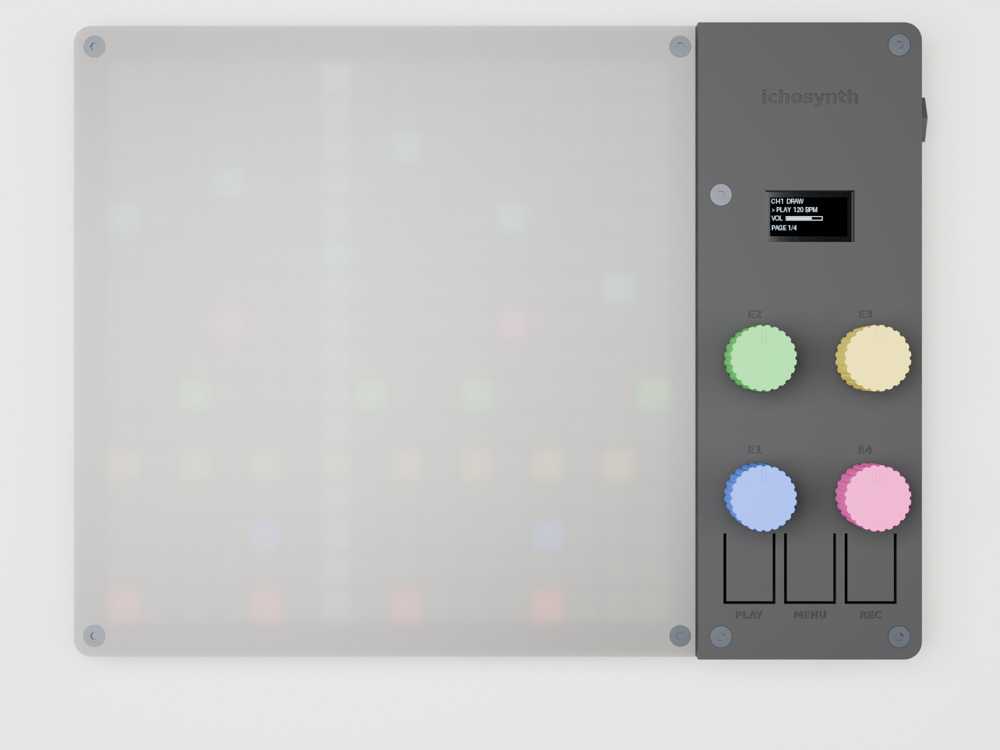</td>
<td width="33%">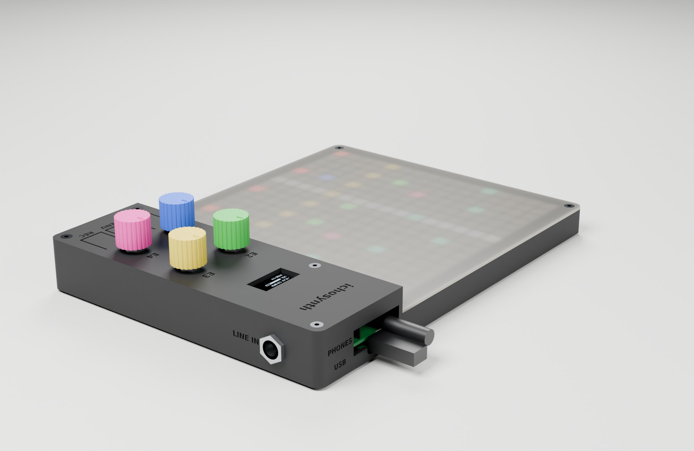</td>
<td width="33%">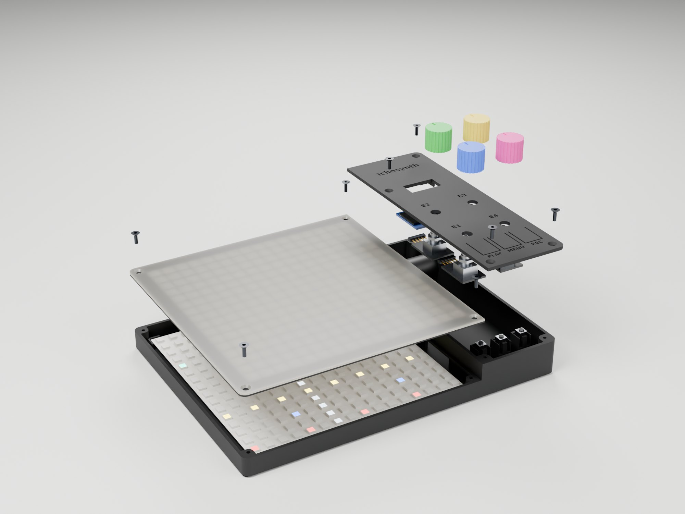</td>
</tr>
<tr>
<td align="center"><sub>16×16 grid · OLED · 4 knobs · 3 buttons</sub></td>
<td align="center"><sub>headphones + USB at the back, LINE IN on the side</sub></td>
<td align="center"><sub>3 printed parts, 8 screws</sub></td>
</tr>
</table>

<sub>Renders of the case generated from the same parametric model that produces the STL files.</sub>

## What it does

- 🥁 **8 sample voices + 3 synth voices**, polyphonic, with per-voice filter, **reverb**, bitcrusher,
  detune, octave and a **Moog ladder** on the synths
- 🟥 **16×16 RGB step grid**: each row a voice, each column a step; pages, sub-patterns and **song mode**
- 🎚️ Per-step **velocity, probability and conditions**, mute, note shift, copy and paste
- 💾 **Sample packs and an SD browser**, with seek, length and reverse; songs saved on the SD card
- 🎙️ **Live recording** into the sampler from a **6.35 mm LINE IN** (field recorder, instruments,
  other gear), with an optional count-in
- 🎧 **Headphone out** (3.5 mm stereo) · 🎹 **DIN MIDI** clock and notes on pins 34/35 (optional circuit)

The SD card already ships with a public-domain sample set ([`sdcard/`](sdcard)). To add your own
sounds, [`wavmaker`](tools/wavmaker) converts any WAV and prepares the card.

<p align="center">
  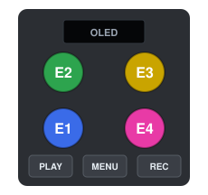
</p>

## Build one

<table>
<tr>
<td width="33%" valign="top">
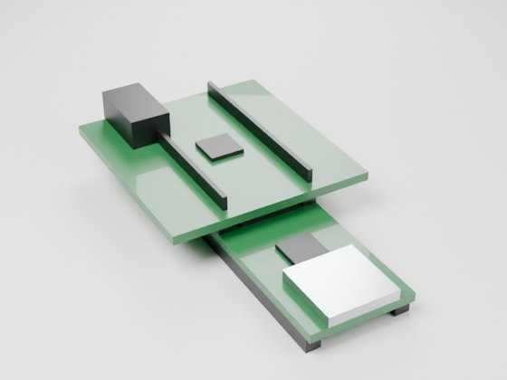<br>
<b>1 · Parts</b><br>
Teensy 4.1 with 16 MB PSRAM, audio board, LED matrix, 4 KY-040, 3 switches, OLED, one jack.
<a href="docs/manuals/BUILD_MANUAL.md#1--what-you-need">Parts list</a>
</td>
<td width="33%" valign="top">
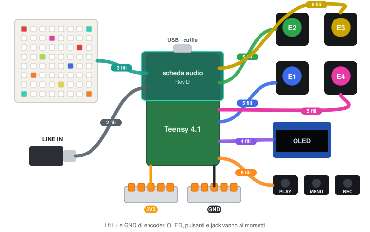<br>
<b>2 · Wire</b><br>
Point to point, no PCB. Every wire is drawn on the real parts.
<a href="docs/wiring/CABLAGGIO.pdf">Wiring guide (PDF)</a>
</td>
<td width="33%" valign="top">
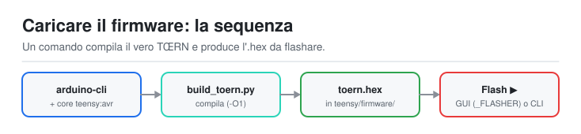<br>
<b>3 · Flash</b><br>
One click with the bundled flasher, no toolchain needed.
<a href="tools/flasher">Flasher</a>
</td>
</tr>
<tr>
<td valign="top">
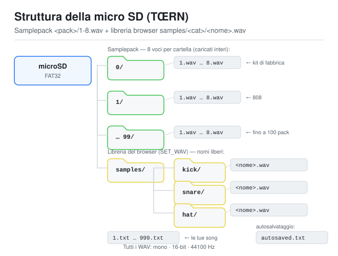<br>
<b>4 · SD card</b><br>
Copy <code>sdcard/</code> to a FAT32 micro-SD, or let <code>wavmaker</code> do it.
<a href="sdcard/README.md">SD layout</a>
</td>
<td valign="top">
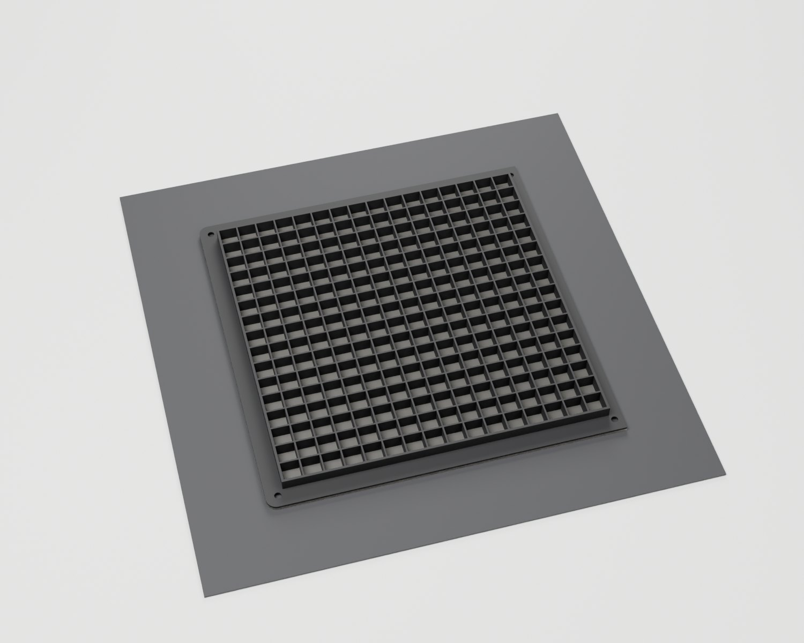<br>
<b>5 · Print</b><br>
3 parts on 2 plates, no supports. Ready-made Anycubic Slicer Next projects (PLA or PETG).
<a href="case">Case</a>
</td>
<td valign="top">
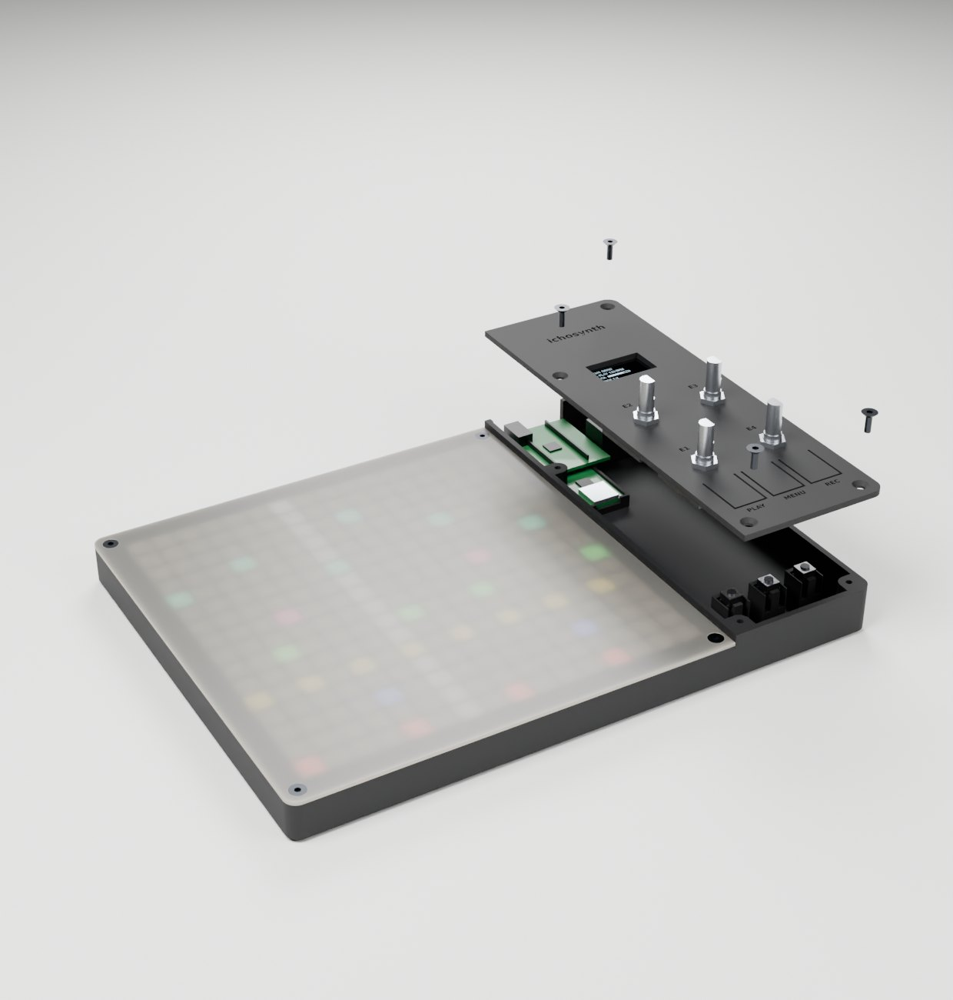<br>
<b>6 · Assemble</b><br>
An IKEA-style picture guide, step by step.
<a href="case/MONTAGGIO.pdf">Assembly guide (PDF)</a>
</td>
</tr>
</table>

> 💾 The Teensy needs **both PSRAM chips (16 MB)** soldered: TŒRN uses about 16.5 MB and won't
> start without them.

## Documentation

| | 🇬🇧 English | 🇮🇹 Italiano |
|---|---|---|
| 🔧 **Build manual**: parts, soldering, wiring, case, firmware | [read](docs/manuals/BUILD_MANUAL.md) · [PDF](docs/manuals/BUILD_MANUAL.pdf) | [leggi](docs/manuals/MANUALE_COSTRUZIONE.md) · [PDF](docs/manuals/MANUALE_COSTRUZIONE.pdf) |
| 🎛️ **Usage manual**: how to play | [read](docs/manuals/USAGE_MANUAL.md) · [PDF](docs/manuals/USAGE_MANUAL.pdf) | [leggi](docs/manuals/MANUALE_USO.md) · [PDF](docs/manuals/MANUALE_USO.pdf) |
| 💻 **Dev environment**: build the firmware yourself | [read](docs/manuals/DEV_ENVIRONMENT.md) · [PDF](docs/manuals/DEV_ENVIRONMENT.pdf) | [leggi](docs/manuals/MANUALE_AMBIENTE.md) · [PDF](docs/manuals/MANUALE_AMBIENTE.pdf) |
| 🔌 **Wiring guide**, illustrated | | [CABLAGGIO.pdf](docs/wiring/CABLAGGIO.pdf) |
| 🧩 **Case assembly**, pictures only | | [MONTAGGIO.pdf](case/MONTAGGIO.pdf) |
| 🎛️ **Control map** and feature list | | [MAPPA_CONTROLLI](docs/reference/MAPPA_CONTROLLI.md) · [FEATURE_INVENTORY](docs/reference/FEATURE_INVENTORY.md) |
| 🎓 **Workshop** material: slides, handout, teacher notes | | [`docs/workshop/`](docs/workshop) |

## Firmware

The firmware is built by one script, which fetches TŒRN at a pinned commit, applies the pin
remap and the small hardware patches, adds the OLED and compiles:

```sh
python firmware/build_toern.py            # -> firmware/build/toern.hex
python firmware/build_toern.py --flash    # build and flash
```

It needs [`arduino-cli`](https://arduino.github.io/arduino-cli/) with the `teensy:avr` core. The
build uses `-O1`, because `-O2` crashes the Teensy compiler on TŒRN's single 23,000-line
translation unit. Every patch is listed in [`firmware/README.md`](firmware/README.md). The ready-made
`.hex` ships with the flasher in [`tools/flasher/`](tools/flasher).

<details>
<summary><b>📌 Pin map</b></summary>

| Function | Teensy pins |
|---|---|
| E1 · E2 · E3 · E4 encoders (CLK / DT / SW) | `5 / 22 / 15` · `32 / 33 / 41` · `9 / 14 / 16` · `37 / 38 / 39` |
| PLAY · MENU · REC buttons (to GND) | `25` · `26` · `28` |
| LED matrix DIN | `17` |
| OLED + audio codec, shared I²C | `SDA 18` / `SCL 19` |
| DIN MIDI (optional) | `34 RX` / `35 TX` |

The authoritative source is the drivers themselves: `ICHOS_ENC_PINS` in
[`i2cEncoderLibV2.h`](firmware/libraries/i2cEncoderLibV2/i2cEncoderLibV2.h) and `ICHOS_BTN_PINS` in
[`FastTouch.h`](firmware/libraries/FastTouch/FastTouch.h). The wiring guide reads its pins from
there too.
</details>

<details>
<summary><b>📂 What's in the repo</b></summary>

```
ichosynth/
├── docs/
│   ├── manuals/     📖 build, usage and dev-environment manuals (EN + IT, .md + .pdf)
│   ├── wiring/      🔌 illustrated wiring guide (CABLAGGIO.pdf) and its generator
│   ├── reference/   🎛️ control map, feature inventory
│   └── workshop/    🎓 ICHOS 2026 workshop material
├── firmware/        🧠 build_toern.py + the three input drivers (KY-040, switches, OLED)
├── case/            🖨️ 3D-printed case: STL, slicer projects, fit checks, renders, assembly guide
├── sdcard/          💾 what goes on the micro-SD: sample packs and the sample library
├── tools/
│   ├── flasher/     ⚡ one-click flasher + the ready-made firmware
│   ├── wavmaker/    🎚️ WAV converter and SD preparation
│   └── pdf/         📄 manual PDF build (+ dev-environment setup scripts)
├── emulator/        🖥️ desktop emulator (Windows / macOS, SDL2)
├── assets/          🎨 diagrams, illustrations, banner
├── design/          🎨 design system for the diagrams
└── legacy/          📜 SP_'s original NI404: bench firmware, PCB, enclosure
```
</details>

## Part of ICHOS 2026

<p align="center">
  
</p>

ichosynth is the instrument the participants **built with their own hands** at
**[ICHOS 2026](https://www.francescogiannico.com/ichos-2026/)**, a residential *sound ecology*
workshop in **Taranto, Italy** (12–14 June 2026), conceived and led by sound artist
**Francesco Giannico**. *Ichos*, from the ancient Greek **ἦχος**, means "sound".

Three days of **listening**, **field recording** in Taranto's marginal places (the abandoned
Circummarpiccolo fish farm, the Galeso river, the Neolithic site of Punta Pizzone), **building
the instrument** and a collective **electroacoustic performance**. The sounds recorded on site
become what the groovebox plays: **record a place, then perform it on an instrument you soldered
yourself.** The workshop is followed by a sonic documentary by **Roberta Trani**.

## Credits

- **SP_ (soundpauli)** wrote **[TŒRN](https://toern.live)**, the firmware this instrument runs,
  and the original **NI404** this repository started from. All credit for them stays with SP_.
- **Paul Stoffregen / PJRC** for the Teensy platform and its Audio library; **Nic Newdigate** for
  `teensy-polyphony` and `teensy-variable-playback`.
- **ICHOS 2026** is conceived and led by **Francesco Giannico**. The ichosynth build, case and
  documentation are by **Luigi Massari**, documentary by **Roberta Trani**.

**Libraries**: TŒRN (SP_, MIT) · Teensy Audio · `teensy-polyphony` / `teensy-variable-playback`
· `WS2812Serial` · FastLED · Mapf (GPL-3.0) · the bundled `i2cEncoderLibV2`, `FastTouch` and
`IchosOled` drivers.

## License

**MIT**, see [LICENSE](LICENSE). TŒRN and each library keep their own license (Mapf is GPL-3.0):
if you distribute a build, check that you comply with all of them.

<p align="center"><sub>Made in Taranto for ICHOS 2026 · listen to a place, then play it back.</sub></p>
