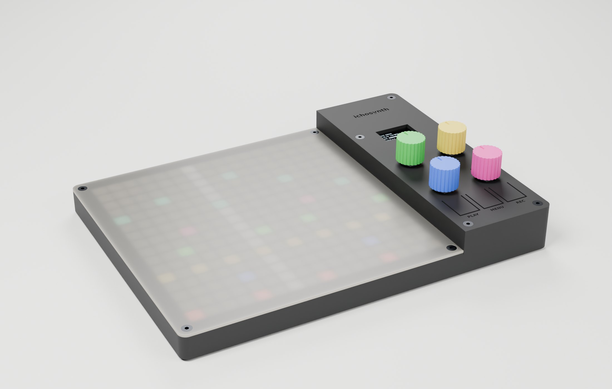

# ichosynth — case stampato in 3D

**Guida di montaggio (tutta grafica): [MONTAGGIO.pdf](MONTAGGIO.pdf)** · versione web [MONTAGGIO.html](MONTAGGIO.html)



Case **a gradino**: la zona matrice è bassa (16 mm), la zona comandi più alta (29 mm)
perché sotto ci sta lo stack Teensy 4.1 + scheda audio impilata. **3 pezzi su 2 piatti**
della **Anycubic Kobra S1** (250 × 250 mm), **nessun supporto**.

| Piatto | File | Pezzo | Materiale |
|---|---|---|---|
| 1 | `stl/plate1.stl` (oppure `tray.stl` + `panel.stl`) | **vasca** + **pannello comandi** | **PETG** nero (consigliato: i tasti flessibili durano di più) o PLA |
| 2 | `stl/window.stl` | **diffusore** della matrice con griglia anti-alone | PLA/PETG **traslucido** |
| — | `stl/knob.stl` | manopola (×4, facoltativa) | qualsiasi |

Gli STL sono già orientati per la stampa (pannello e diffusore capovolti: la faccia a
vista è sul piatto). Case chiuso: **239 × 179 mm**.

## Stampa

- Ugello 0,4 · strato 0,2 mm · 3 perimetri · riempimento 15 % · **niente supporti**.
- **Piatto 1 è pieno (239 × 245 mm su 250 × 250): disattiva skirt e brim** e controlla che
  la linea di spurgo della stampante non finisca sui pezzi. In alternativa stampa
  `tray.stl` e `panel.stl` in due lavori separati.
- **Diffusore: cambio colore a Z = 1,4 mm** (traslucido → nero). Anycubic Slicer Next:
  cursore dei layer → layer a 1,4 mm → *Aggiungi cambio colore* (con l'ACE Pro è
  automatico, altrimenti la stampante va in pausa). Il piano resta traslucido, la griglia
  esce nera → pixel netti. Tutto traslucido funziona lo stesso, con pixel più sfumati.

## Comandi

```
 ┌───────── zona comandi ─────────┐
 │           ichosynth            │   sopra lo stack Teensy + scheda audio
 │           [ OLED ]             │
 │   E2 ◯               ◯ E3      │   E2 pagina · E3 filtro rapido
 │   E1 ◯               ◯ E4      │   E1 cursore Y · E4 cursore X (i più usati, vicino alla mano)
 │  [PLAY]   [MENU]   [REC]       │   tasti flessibili 13 × 19 mm
 └────────────────────────────────┘
```

Ruoli in modalità DRAW di TŒRN (vedi `_DOCS/MAPPA_CONTROLLI.md`). Passo encoder 31 × 38 mm.
In FILTER mode gli slider 1-4 seguono E1…E4, quindi girano "a U" attorno al 2×2.

I **tasti sono ricavati nel pannello**: una linguetta da 0,8 mm che flette (~3 N in PLA,
meno in PETG) e preme il tact switch con un perno (gioco 0,4 mm). Lo switch (**6×6 alto
4,3 mm**) sta su un **piedistallo della vasca**, con un bordino che lo centra e due asole
per le gambe: **salda i due fili su due gambe in diagonale** (così il contatto c'è
sempre, in qualunque verso lo metti) prima di posarlo. Se un tasto resta premuto,
carteggia appena il perno sotto la linguetta. PLAY e MENU sono affiancati per la
combinazione a due dita (FILTER / SAMPLE BROWSER).

**I/O** — retro: **USB** e **PHONES**. Il jack cuffie della scheda audio Rev D sta sullo
stesso lato della USB del Teensy (così la monta anche PJRC/CCRMA): esce direttamente
dall'apertura larga quanto la scheda, niente prolunghe — **controllalo sulla tua scheda
prima di stampare**. Fianco destro: **OUT L · OUT R · IN**, jack mono 6,35 mm da pannello
(foro 9,8 mm, ingombro dietro la parete **max 22 mm di profondità e 16 mm di altezza**).
La **micro-SD** del Teensy si raggiunge togliendo il pannello (4 viti).

**Cablaggio dentro il case** — tutti i fili si **saldano**, niente connettori Dupont:
- KY-040: i 5 pin verso il retro, fili saldati sui pin e piegati **subito verso il basso**
  (fra la fila E1/E4 e la fila E2/E3 ci sono solo 3 mm);
- Teensy: i pin sotto il PCB stanno nella culla, quindi i fili vanno saldati sul **lato
  superiore** del Teensy (sulle saldature degli header) o sui pin passanti della scheda audio.

## Minuteria

| Q.tà | Cosa |
|---|---|
| 8 | vite M3 × 8 testa svasata (si autofilettano nei fori pilota da 2,5 mm) |
| 3 | tact switch 6×6 **alti 4,3 mm** |
| 3 | jack mono TS 6,35 mm da pannello (filetto 3/8") |
| 4 | piedini adesivi Ø10 |
| — | colla a caldo (Teensy, OLED, switch) |

## File

| File | Cosa |
|---|---|
| `build_case.py` | **generatore parametrico** di tutti i pezzi → `stl/` (controlla anche che stiano sul piatto) |
| `parts.py` | componenti acquistati alle quote reali (usati da verifiche e render) |
| `check_fit.py` | verifiche, **exit 1 se qualcosa non va**: interferenze pezzi/componenti/spine, micro-SD estraibile, matrice spostata del gioco massimo, corsa dei tasti, pezzi in un corpo unico, griglia attaccata |
| `render/scenes.py` | prepara le scene per Blender (mesh, camere, frecce) |
| `render/blender_render.py` | render Cycles (materiali PLA/PCB/metallo, LED accesi sotto il diffusore) |
| `render/render.ps1` | lancia Blender **a priorità bassa e con pochi thread** (il PC resta usabile) |
| `render/make_guide.py` | impagina la guida grafica → `MONTAGGIO.html` + `MONTAGGIO.pdf` (Chrome/Edge headless) |

```sh
pip install manifold3d trimesh numpy matplotlib pillow
python _CASE/build_case.py                      # STL
python _CASE/check_fit.py                       # verifiche
powershell -File _CASE/render/render.ps1        # render (Blender 4.2+), ~1-2 min a scena
python _CASE/render/make_guide.py               # guida HTML + PDF
```

Tutte le quote sono parametri in testa a `build_case.py`. **Da misurare sui tuoi
componenti prima di stampare**: lato della matrice (160 mm), altezza dello stack
Teensy+audio (header da 11 mm → `STACK_GAP`), area attiva dell'OLED (finestra 25 × 14,5 mm
centrata sul modulo), altezza degli switch (`SW_H` = 4,3 mm). Dopo una modifica rilancia
`build_case.py` e `check_fit.py`.
