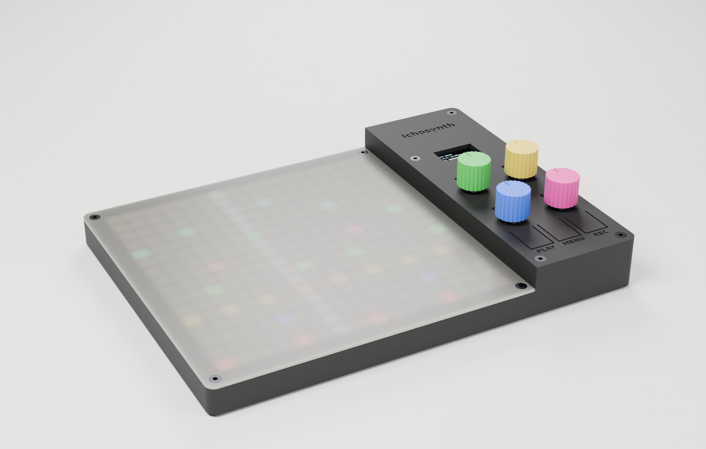

# ichosynth — case stampato in 3D

**Guida di montaggio (tutta grafica): [MONTAGGIO.pdf](MONTAGGIO.pdf)** · versione web [MONTAGGIO.html](MONTAGGIO.html)



Case **a gradino**: la zona matrice è bassa (16 mm), la zona comandi più alta (28,5 mm)
perché sotto ci stanno lo stack Teensy 4.1 + scheda audio (pin lunghi con i fili saldati in
cima, e l'OLED sopra) e il jack LINE IN. **3 pezzi su 2 piatti**
della **Anycubic Kobra S1** (250 × 250 mm), **nessun supporto**.

| Piatto | File | Pezzo | Materiale |
|---|---|---|---|
| 1 | `stl/plate1.stl` (oppure `tray.stl` + `panel.stl`) | **vasca** + **pannello comandi** | **PETG** nero (consigliato: i tasti flessibili durano di più) o PLA |
| 2 | `stl/window.stl` | **diffusore** della matrice con griglia anti-alone | **traslucido** + nero, stesso materiale (tutto PLA o tutto PETG) |
| — | `stl/knob.stl` | manopola (×4, facoltativa) | qualsiasi |

Gli STL sono già orientati per la stampa (pannello e diffusore capovolti: la faccia a
vista è sul piatto). Case chiuso: **239 × 179 mm**.

## Stampa

- Ugello 0,4 · strato 0,2 mm · 3 perimetri · riempimento 15 % · **niente supporti**.
- **Piatto 1 è pieno (239 × 245 mm su 250 × 250): disattiva skirt e brim** e controlla che
  la linea di spurgo della stampante non finisca sui pezzi. In alternativa stampa
  `tray.stl` e `panel.stl` in due lavori separati.
- **Diffusore: cambio colore a Z = 1,4 mm** (traslucido → nero). Anycubic Slicer Next:
  cursore dei layer → layer **1,6 mm** (il primo nero, quello da 1,4 a 1,6: lo slicer
  chiama i layer con la quota di sopra) → *Aggiungi cambio colore* (con l'ACE Pro è
  automatico, altrimenti la stampante va in pausa). Il piano resta traslucido, la griglia
  esce nera → pixel netti. Tutto traslucido funziona lo stesso, con pixel più sfumati.
  **Griglia e piano devono essere dello stesso materiale**: il PETG non si attacca al PLA
  (si usano come interfaccia di distacco dei supporti), la griglia si staccherebbe.

### Progetto pronto: Kobra S1 Combo + ACE Pro

**`ichosynth_case_S1Combo.3mf`** — aprilo in Anycubic Slicer Next (*File → Apri progetto*,
alla domanda carica anche le impostazioni). È già tutto dentro: stampante *Anycubic Kobra S1
0.4 nozzle*, processo *0.20mm Standard* con 3 perimetri e niente brim/skirt, due piatti.

- **ACE Pro: slot 1 = PLA nero, slot 2 = PLA traslucido** (preset *Anycubic PLA* e *Anycubic
  PLA Translucent*). Se li hai in altri slot, sposta le bobine o rimappa gli slot quando
  invii la stampa; non cambiare l'ordine dei filamenti nel progetto (il cambio sul piatto 2
  punta allo slot 1).
- **Piatto 1** — vasca + pannello, tutto slot 1. ~4 h 45', ~170 g (stime dello slicer).
- **Piatto 2** — diffusore: slot 2 per i primi 7 layer (0–1,4 mm), poi **cambio automatico
  allo slot 1** al layer 1,6 (c'è già, lo vedi come segno sul cursore dei layer) e una piccola
  torre di spurgo nell'angolo davanti a sinistra. ~2 h 30', ~50 g traslucido + ~44 g nero.
- Prima di stampare controlla: *Slice* di ogni piatto senza avvisi; sul piatto 2 i pezzi
  stanno al centro del piatto (non fuori bordo) e nell'anteprima il layer 1,4 è traslucido e
  l'1,6 nero; nessun brim/skirt; la linea di spurgo della S1 è fuori dal piatto (Y = 255, dietro
  i pezzi), quindi il piatto 1 pieno non è un problema. Il tipo di piatto è *High Temp Plate*:
  se usi il PEI testurizzato cambialo in alto.
- **Tutto in PETG?** `ichosynth_case_S1Combo_PETG.3mf`: slot 1 = PETG nero, slot 2 = PETG
  traslucido (preset *Anycubic PETG* per entrambi), stessi piatti e stesso cambio. I tasti
  flessibili del pannello durano di più. ~5 h 15' + ~2 h 45'.
- **Mai PLA e PETG nello stesso pezzo**: non si attaccano fra loro, per questo i progetti sono
  due, ognuno tutto di un materiale.

Il progetto si rigenera dagli STL (dopo `build_case.py`) e si verifica facendo lo slicing
da riga di comando, senza aprire lo slicer (a priorità bassa, non tocca le impostazioni):

```sh
python case/make_slicer_project.py --verifica          # -> ichosynth_case_S1Combo.3mf + controlli
python case/make_slicer_project.py --petg --verifica   # variante PETG
```

## Comandi

```
 ┌───────── zona comandi ─────────┐
 │           ichosynth            │   sopra lo stack Teensy + scheda audio
 │           [ OLED ]             │
 │   E2 ◯               ◯ E3      │   E2 pagina · E3 filtro rapido
 │   E1 ◯               ◯ E4      │   E1 cursore Y · E4 cursore X (i più usati, vicino alla mano)
 │  [PLAY]   [MENU]   [REC]       │   tasti flessibili 13 × 19 mm
 └────────────────────────────────┘
```

Ruoli in modalità DRAW di TŒRN (vedi `docs/reference/MAPPA_CONTROLLI.md`). Passo encoder 31 × 38 mm.
In FILTER mode gli slider 1-4 seguono E1…E4, quindi girano "a U" attorno al 2×2.

I **tasti sono ricavati nel pannello**: una linguetta da 0,8 mm che flette (~3 N in PLA,
meno in PETG) e preme il tact switch con un perno (gioco 0,4 mm). Lo switch (**6×6 alto
4,3 mm**) sta su un **piedistallo della vasca**, con un bordino che lo centra e due asole
per le gambe: **salda i due fili su due gambe in diagonale** (così il contatto c'è
sempre, in qualunque verso lo metti) prima di posarlo. Se un tasto resta premuto,
carteggia appena il perno sotto la linguetta. PLAY e MENU sono affiancati per la
combinazione a due dita (FILTER / SAMPLE BROWSER).

**I/O** — retro: **USB** e **PHONES**. Il jack cuffie della scheda audio Rev D sta sullo
stesso lato della USB del Teensy (così la monta anche PJRC/CCRMA): esce direttamente
dall'apertura larga quanto la scheda, niente prolunghe — **controllalo sulla tua scheda
prima di stampare**. Fianco destro: **LINE IN**, jack mono 6,35 mm da pannello
(foro 9,8 mm, ingombro dietro la parete **max 22 mm di profondità e Ø20 mm**: va bene
anche quello tondo con la rondella). Il jack sta **davanti alla scheda audio**, sotto l'OLED: la punta
della spina inserita sporge dal fondo del jack e passa a 4 mm dal Teensy (sul prototipo, più
indietro, urtava la scheda audio; `check_fit` ora simula la spina da 32 mm).
La **micro-SD** del Teensy si raggiunge togliendo il pannello (4 viti).

**Cablaggio dentro il case** — tutti i fili si **saldano**, niente connettori Dupont:
- KY-040: i 5 pin verso il retro, fili saldati sui pin e piegati **subito verso il basso**
  (fra la fila E1/E4 e la fila E2/E3 ci sono solo 3 mm);
- Teensy: i pin sotto il PCB stanno nella culla, quindi i fili vanno saldati sul **lato
  superiore** del Teensy (sulle saldature degli header) o sui pin passanti della scheda audio.

## Minuteria

| Q.tà | Cosa |
|---|---|
| 8 | vite M3 × 8 testa svasata (si autofilettano nei fori pilota da 2,5 mm) |
| 3 | tact switch 6×6 **alti 4,3 mm** |
| 1 | jack mono TS 6,35 mm da pannello (filetto 3/8") per il LINE IN |
| 4 | piedini adesivi Ø10 |
| — | colla a caldo (Teensy, OLED, switch) |

## File

| File | Cosa |
|---|---|
| `build_case.py` | **generatore parametrico** di tutti i pezzi → `stl/` (controlla anche che stiano sul piatto) |
| `parts.py` | componenti acquistati alle quote reali (usati da verifiche e render) |
| `make_slicer_project.py` | progetto **Anycubic Slicer Next** (`ichosynth_case_S1Combo*.3mf`): 2 piatti, preset S1, slot ACE, cambio filamento; `--verifica` fa lo slicing headless e controlla il G-code |
| `check_fit.py` | verifiche, **exit 1 se qualcosa non va**: interferenze pezzi/componenti/spine, micro-SD estraibile, matrice spostata del gioco massimo, corsa dei tasti, pezzi in un corpo unico, griglia attaccata |
| `mutation_test.py` | prova le verifiche: introduce difetti apposta (stack più alto, pin più lunghi, jack più grosso…) e controlla che `check_fit` se ne accorga |
| `render/scenes.py` | prepara le scene per Blender (mesh, camere, frecce) |
| `render/blender_render.py` | render Cycles (materiali PLA/PCB/metallo, LED accesi sotto il diffusore) |
| `render/render.ps1` · `render/render.sh` | lancia Blender **a priorità bassa e con pochi thread** (il PC resta usabile); `.ps1` per Windows, `.sh` per macOS/Linux |
| `requirements.txt` | pacchetti Python di tutti gli script del case |
| `render/make_guide.py` | impagina la guida grafica → `MONTAGGIO.html` + `MONTAGGIO.pdf` (Chrome/Edge headless) |

```sh
pip install -r case/requirements.txt
python case/build_case.py                      # STL
python case/check_fit.py                       # verifiche
python case/mutation_test.py                   # le verifiche se ne accorgono? (tutte OK)
powershell -File case/render/render.ps1        # render (Blender 4.2+), ~1-2 min a scena
case/render/render.sh                          # idem su macOS/Linux
python case/render/make_guide.py               # guida HTML + PDF
```

Tutte le quote sono parametri in testa a `build_case.py`. **Da misurare sui tuoi
componenti prima di stampare**: lato della matrice (160 mm), altezza dello stack
Teensy+audio (scheda audio appoggiata sulla plastica dell'header → `STACK_GAP` = 2,6 mm;
punte dei pin 10,9 mm sopra il PCB del Teensy con pettini da 15 mm → `HDR_PIN_UP`), area
attiva dell'OLED (finestra 25 × 12,5 mm, spostata di 1 mm verso i pin perché dal lato
opposto il vetro ha una fascia spenta), altezza degli switch (`SW_H` = 4,3 mm). Dopo una
modifica rilancia `build_case.py` e `check_fit.py`.

L'OLED è **3 mm a destra del centro** del pannello: così i suoi pin non stanno sopra la fila
destra del Teensy, dove sul pin 41 (SW di E2) è saldato un filo (`check_fit` vuole almeno
2,5 mm fra i pin).

Primo prototipo stampato (ottobre 2026): con la zona comandi 7 mm più bassa i pin lunghi del
Teensy, con i fili saldati in cima, toccavano l'OLED e sollevavano il pannello; le scritte
piccole si chiudevano nel primo strato. Entrambe le cose sono corrette in questa versione.
